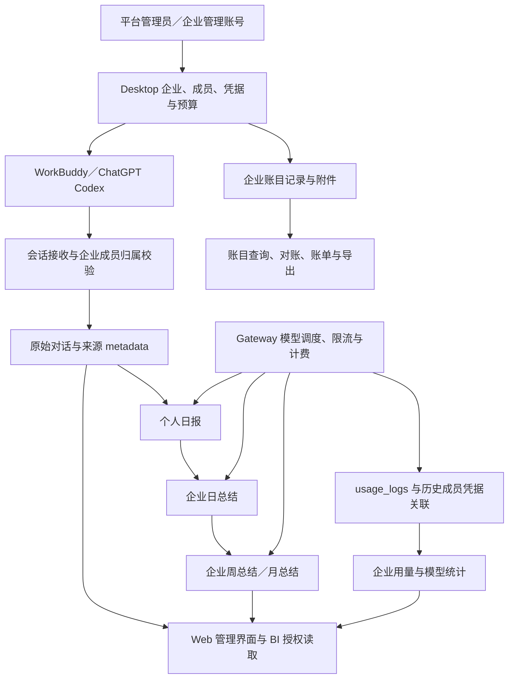

# 企业管理规划与当前实现对照分析

分析日期：2026-10-20。需求基线为提交 `ec31174001bbe60d6a211c3ccbd9c08406216eae` 中的 [企业管理后端业务设计](enterprise-organization-plan.md)，源码基线为本地 `main` 的 `3a2b9d32ec59eddb5240f91a1e2cb46b035528fc`。该需求文档在两个提交之间没有变化。

本报告分析与该规划有关的当前代码，不将历史模块、演示页面或规划内容计为现有能力。「已实现」表示存在对应源码链路，不代表已完成生产验收。基线文档本身明确是业务设计，未开展实现，也保留了多项待确认规则，见 [文档第 170 行](enterprise-organization-plan.md#工作规划)。

本报告保留 2026-10-20 实施前的代码分析。2026-10-21 开始的部门、岗位与员工归属变更见 [实施方案](enterprise-organization-implementation-plan.md) 和 [使用与部署说明](../desktop/DESKTOP_ORGANIZATION_STRUCTURE.md)。

## 结论

当前项目已形成以 AI 使用为入口的企业管理链路：企业和成员配置、模型凭据与预算、对话接收、个人日报、企业日总结、企业周月总结，以及 Web 和独立微信 BI 身份的授权阅读。另外，账目模块已经按企业管理订单、合同、发票、收付款和附件等业务记录。

相对于规划，当前主要覆盖「企业 AI 使用与对话归集、管理总结」和部分企业经营记录。部门与岗位、通用工作成果、多业务系统接入、企业知识库、岗位与部门 SOP，以及面向明确接收方的数据上报，尚未形成业务闭环。现有会话与日报可为这些能力提供来源材料，但不能直接视为已验收成果或企业认可的方法。

最关键的技术选择是复用已有 Desktop 和 Gateway：Desktop 持有企业、成员、对话和报告，Gateway 提供模型调度、用量与预算；BI v2 读取这些原始数据，不再建立独立事实复制和 Connector 链路。

## 需求与功能对照

| 规划方向 | 当前状态 | 实现与限制 | 主要证据 |
| --- | --- | --- | --- |
| 企业管理 | 已实现基础能力 | 企业编码、状态、承载用户、Gateway 分组、成员上限、模型配置、总结开关和管理策略 | [企业 schema](../../backend/ent/schema/desktop_organization.go#L30)、[管理 API](../../backend/internal/server/routes/admin.go#L180) |
| 员工管理 | 已实现基础能力 | 企业内成员、姓名、手机号、备注、状态、凭据轮换和预算；成员直接关联企业 | [成员 schema](../../backend/ent/schema/desktop_member.go#L27)、[成员创建](../../backend/internal/service/desktop_service.go#L210) |
| 部门 → 岗位 → 员工 | 未实现 | 成员没有岗位外键，未见部门、岗位实体和「恰好一个」约束；Gateway 分组、联系人角色不代表组织岗位 | [成员 schema](../../backend/ent/schema/desktop_member.go#L27)、[BI 功能状态](../../backend/internal/bi/desktop_http.go#L101) |
| 低负担采集 | 已有后端接收能力 | 接收 WorkBuddy、ChatGPT Codex 对话，保存来源、时间、缺失和截断信息；客户端是否完整自动采集仍需另外验收 | [输入结构](../../backend/internal/service/desktop_conversation.go#L39)、[客户端限制](../../backend/internal/service/desktop_conversation.go#L228) |
| 员工工作成果 | 部分覆盖来源材料 | 已保存对话及 AI 归集内容；没有独立的通用成果对象、交付物版本、任务关联和完成认定流程 | [会话结构](../../backend/internal/service/desktop_conversation.go#L39)、[日报处理](../../backend/internal/service/desktop_report_service.go#L425) |
| 多系统数据汇集 | 尚未形成通用能力 | 当前会话入口限于两类客户端；账目是内部业务模块，未见 CRM、项目、采购等系统的统一接入和对象映射 | [会话校验](../../backend/internal/service/desktop_conversation.go#L194)、[账目业务种类](../../backend/internal/accounting/types.go#L76) |
| 数据来源与去重 | 当前链路部分实现 | 会话 ID 唯一、企业与成员校验、来源引用、报告快照和覆盖提示；未形成跨系统同一业务对象的去重、冲突和更正机制 | [会话写入](../../backend/internal/repository/desktop_conversation_repo.go#L28)、[周期来源比对](../../backend/internal/repository/desktop_period_repo.go#L286) |
| 管理查看与汇总 | 已实现当前范围 | 企业用量、模型、成员、客户端、会话、日／周／月总结；不等于企业全部业务和成果统计 | [BI 路由](../../backend/internal/bi/routes.go#L24)、[原生用量查询](../../backend/internal/repository/desktop_native_analytics.go#L48) |
| 企业数据上报 | 目标待定义，未形成通用链路 | 有会话入站、报告查看／复制和账目导出；未见针对明确外部接收方的报送任务、回执和更正流程 | [BI 路由](../../backend/internal/bi/routes.go#L24)、[账目导出](../../backend/internal/accounting/handler.go#L40)、[规划边界](enterprise-organization-plan.md#沉淀与上报的价值方向) |
| 企业知识库 | 未接入 | 当前生产接口显式返回 knowledge 为 unsupported/not_connected；未见成果转知识、版本、检索和引用复用闭环 | [功能状态](../../backend/internal/bi/desktop_http.go#L101)、[当前 BI 范围](../mobile-bi/README.md#当前范围) |
| 岗位／部门 SOP | 未实现 | 未见岗位关联、草稿与认可状态、业务审核、适用条件、失效更新和执行反馈流程 | [当前保留设计](../mobile-bi/data-model-and-metrics.md#保留的-bi-设计)、[需求中的认可要求](enterprise-organization-plan.md#ai-辅助整理与-sop-的可信度) |
| 企业数据资产 | 已有原始积累，复用能力待建设 | 对话、报告、计费和账目记录可以积累；尚无完整的「成果 → 知识 → SOP → 使用反馈」链路 | [日报处理](../../backend/internal/service/desktop_report_service.go#L425)、[BI 未接入能力](../../backend/internal/bi/desktop_http.go#L101) |

## 当前方案如何运行

### 企业身份与模型使用

企业通过 `gateway_user_id` 关联原站承载账号，通过 `group_id` 使用 Gateway 模型分组。成员属于企业，成员的当前与历史 Model Token 存在 `desktop_member_api_keys`。这种关系支持凭据轮换后继续归集历史用量，而无需给每个员工创建独立的原站账号。

企业负责人员入口通过当前 Web 身份解析企业，Repository 还提供 `ScopedToGatewayUser` 限制操作范围。平台管理员使用单独管理路由。Gateway 分组控制模型资源与访问，不具备部门含义。

证据：[企业关系](../../backend/ent/schema/desktop_organization.go#L53)、[凭据历史](../../backend/ent/schema/desktop_member_api_key.go#L15)、[企业服务范围](../../backend/internal/service/desktop_service.go#L141)、[Web 管理路由](../../backend/internal/server/routes/user.go#L186)。

### 对话接收与来源保留

常规上报通过 Desktop session 认证，校验正文中的企业、成员、安装 ID 与会话一致；随后检查上报开关、执行成员限流，再入库。Repository 在事务中再次锁定并检查上报开关，避免企业已经关闭上报但旧鉴权快照仍允许写入。

记录保留 `recordId`、客户端、安装 ID、源 session／turn、开始／结束时间、Prompt、Response、`captureStatus` 和截断标记。重复记录 ID 返回冲突；这能防止相同 ID 重复写入，但不构成跨系统业务内容去重。当前正文也没有独立交付文件、成果状态或岗位归属字段。

证据：[输入与校验](../../backend/internal/service/desktop_conversation.go#L39)、[常规接收](../../backend/internal/service/desktop_conversation.go#L239)、[事务写入](../../backend/internal/repository/desktop_conversation_repo.go#L28)。

### 总结生成与任务恢复

日总结分两阶段：从当日会话生成个人日报，再从成功的个人日报生成企业总结。无会话不调用模型；部分成员失败时保留成功结果并反映缺失。内置 Prompt 要求区分用户描述、AI 建议和实际完成结果，不根据缺失数据推断员工工作，也不做绩效评分。

执行采用 PostgreSQL 任务表、`FOR UPDATE SKIP LOCKED`、lease token 与续租，支持多实例竞争任务；checkpoint 保存分批输入、输出及进度。实际 AI 调用前先保存执行记录，再复用 Gateway 调度和计费。长输入分块后归并，失败重试，预算或配置不满足时等待恢复。

周总结和月总结均只使用对应日期的企业日总结，冻结来源正文、版本和指纹。retry 沿用既有来源，regenerate 创建新版本；来源变化会被提示，不自动覆写既有结果。

这些机制解决了任务恢复、用量留痕和报告来源一致性，但 Prompt 约束并不等于业务事实验收，多层摘要也可能损失细节。

证据：[日报 Prompt](../../backend/internal/service/desktop_report_service.go#L15)、[两阶段处理](../../backend/internal/service/desktop_report_service.go#L425)、[生成与执行记录](../../backend/internal/service/desktop_summary_generation.go#L26)、[任务竞争与保存](../../backend/internal/repository/desktop_period_repo.go#L226)、[周月来源规则](../mobile-bi/period-reports.md)。

### BI 与管理端

BI 使用独立微信身份 `BIUser`，通过企业邀请取得按企业划分的 capabilities。BIUser 是数据阅读者身份，DesktopMember 是员工身份，两者不能直接等同。权限区分用量、成员、对话、报告和复制；读取敏感内容还要求相应依赖权限。

BI v2 直接调用 Desktop 服务，按需读取用量、成员、模型、对话和报告。用量基于 `usage_logs` 与历史成员 Key 查询，响应内采用 Repeatable Read；分页可共享 `as_of`。固定截止时间不能阻止之后写入的迟到日志，所以实时统计与冻结报告来源具有不同的一致性边界。

小程序响应经过字段投影，列表和详情分开；运维接口侧重任务和计费 metadata。BI 不再复制独立事实，也没有继续启用旧 Connector。migration 257 明确退役旧导入、知识等对象，历史 SQL 文件不能当作当前功能证据。

证据：[独立身份](../../backend/internal/bi/auth.go#L32)、[企业授权](../../backend/internal/bi/access.go#L47)、[读取能力检查](../../backend/internal/bi/desktop_http.go#L40)、[统计事务](../../backend/internal/repository/desktop_native_analytics.go#L28)、[旧对象退役](../../backend/migrations/257_bi_independent_users.sql#L1)。

### 企业账目与资源分发

账目模块复用 Desktop 企业 ID，具有订单、合同、发票、收付款、卡与交易、费用、附件、核销、成本分摊、对账、关账和账单导出等入口。企业负责人读取自己的、按当前可见规则筛选的数据。它已经提供部分结构化经营事实，可以成为未来汇集的来源之一；目前未见把这些记录接入 Desktop AI 总结输入的链路。

项目也支持 `mcp`／`skill` 资源包的版本与分发。该模块可以承载工具能力，但当前没有与员工成果、岗位、知识审核和 SOP 生效流程建立关联。

证据：[账目入口](../../backend/internal/accounting/handler.go#L24)、[业务流程](../../backend/internal/accounting/workflow_http.go#L36)、[企业阅读范围](../../backend/internal/accounting/handler.go#L199)、[资源类型限制](../../backend/internal/service/desktop_resource_service.go#L87)。

## 方案评价与主要边界

| 方面 | 当前取舍 | 对规划的影响 |
| --- | --- | --- |
| 架构复用 | 同一 Go 服务中扩展 Desktop、BI 和 accounting，复用 Gateway、PostgreSQL、Redis 及 Vue 后台 | 现阶段减少重复身份、计费和事实副本，后续可沿用企业边界扩展 |
| 汇集范围 | 围绕两类 AI 客户端的会话和内部账目记录 | 能解释 AI 使用及部分经营事项，不能代表企业全部工作 |
| 数据模型 | 企业直接关联成员，报告主要是 Markdown 与任务状态 | 组织历史、任务结果、成果验收、知识版本等仍需明确业务对象 |
| 可信度 | 来源 ID、快照、覆盖提示、执行审计已具备 | 保证生成输入可查与执行可追踪；无法自动证明描述的成果已完成 |
| 可靠性 | lease、checkpoint、分块归并、预算控制、部分成功 | 适合后台总结任务；未构成外部业务系统接入或报送可靠性方案 |
| 保留 | 会话、报告、执行记录分别配置保留周期并保护活动任务 | 满足清理需要；长期知识不能只引用会过期的原始会话，应另定证据保留规则 |

### 优先核实：direct webhook 的来源认证

`POST /api/desktop/v1/conversation-records/direct` 在 Desktop 启用时挂载于根路由，路由链只有审计与 body limit，没有 Desktop session、管理员认证或 webhook 签名。Handler 从 `organizationId`／`memberId` headers 取 ID，并要求它们与正文一致；Service 再检查企业、成员状态和上报开关。

这与当前 OpenAPI 中「不使用管理员 Bearer 或 x-api-key」的描述一致，所以属于当前契约选择。其限制是：组织与成员 ID 一致证明了归属字段一致，不能认证调用者或内容来源。可访问该端点且掌握有效 ID 的调用方，在满足其他校验时可以写入该成员名下的对话，随后可能被用于管理总结。若用于可信成果归集，应先明确可信网络边界或带身份的接入凭证；本次没有检查生产反向代理策略，也没有访问生产端点。

现有 handler unit test 就是在未提供凭据时成功写入，能够复核此行为；Handler 仍有「admin route middleware 已认证」的注释，与当前挂载方式和契约不一致。

证据：[实际挂载](../../backend/internal/server/router.go#L145)、[路由中间件](../../backend/internal/server/routes/desktop.go#L38)、[header 处理](../../backend/internal/handler/desktop_conversation_handler.go#L48)、[现有测试](../../backend/internal/handler/desktop_conversation_handler_test.go#L134)、[OpenAPI](../desktop/openapi/DESKTOP_SESSION_CONVERSATION_V2.openapi.json#L796)。

## 后续推进判断

以下是基于现有实现的建议，不是已确认的新需求或本次开发承诺。

1. 先补组织归属与历史规则：复用 Desktop 企业、成员 ID，明确部门和岗位、唯一归属、调岗／离职及历史数据展示口径。不能只增加一个可空 `position_id` 就认定满足「每个员工恰好一个岗位」。
2. 选择一个真实业务场景定义成果：明确交付物、任务背景、来源、版本、阶段／完成认定和可见范围。对话和 AI 日报保留为证据材料，完成认定应有独立业务依据。
3. 通过一个真实系统验证汇集：先明确源对象 ID、版本／更正、更新时间、重复与冲突规则、维护责任和覆盖范围，再决定接入方式。无需因旧 Connector 存在历史代码就整体恢复旧架构。
4. 在可核实成果上建设知识与 SOP：补充适用条件、来源版本、共享范围、草稿／认可状态、确认责任、更新失效和实际引用反馈；岗位 SOP 与部门协作 SOP 分别定义。
5. 在明确上报接收方、用途、口径与频率后设计报送流程。现有阅读、复制、CSV 导出可以复用，但不能直接计为跨系统自动上报。

## 本次验证与限制

- 实际工具：`/opt/homebrew/bin/go`，`go version go1.27.2 darwin/arm64`，与当前 `backend/go.mod` 和 CI 要求一致。
- 已运行并通过：`env -u OPENAI_API_KEY go test -tags=unit ./internal/server/routes ./internal/service ./internal/bi -run 'BI|Desktop(Conversation|Report|Period|Summary|OrganizationUsage|MemberRemark)' -count=1 -timeout=5m`。三个 package 均通过。
- 已运行并通过：`env -u OPENAI_API_KEY go test -tags=unit ./internal/handler -run 'TestDesktopDirectConversationWebhookUsesMemberValidation' -count=1 -timeout=3m`，复核 direct webhook 现有的无凭据写入与成员字段不一致拒绝行为；该测试使用 Repository 替身，不代表生产端点验证。
- 新增的是分析文档，未修改 Go 或前端代码。本次不执行全量后端 lint、全量 unit／integration、前端 lint／typecheck／build、真实微信、生产模型、设备、容量及生产部署验收；上述检查均不视为本次通过。
- [既有验收进度](../mobile-bi/acceptance-progress.md) 是 2026-10-13 的记录，列有本地联调证据和未验收范围，不能替代当前提交的完整运行验证或生产验收。
- 文档引用的源码行号对应上述 HEAD；源码变化后应重新核对。未执行 commit、push、PR 或发布。
