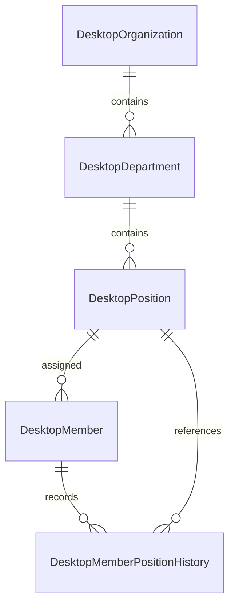

# 部门、岗位与员工归属实施方案

状态：已按本方案实施，验证与上线边界见 [使用及分阶段部署说明](../desktop/DESKTOP_ORGANIZATION_STRUCTURE.md)。

设计日期：2026-10-20。依据为 `ec31174001bbe60d6a211c3ccbd9c08406216eae` 提交的 [企业管理业务规划](enterprise-organization-plan.md)，代码核对基线为 `3a2b9d32ec59eddb5240f91a1e2cb46b035528fc`。现状见 [实现分析](enterprise-implementation-analysis-2026-10-20.md)。

本文把唯一归属要求转为实施方案。用户于 2026-10-21 要求开始实施，本次沿用本文的单层部门、企业负责人维护、岗位不跨部门移动及分阶段迁移选择。生产真实名单补齐、最终约束启用和部署分别进行，不用测试数据替代真实归属。

## 1. 目标与第一版范围

第一版完成企业内的部门、岗位管理，以及员工唯一岗位归属、调岗记录、存量补齐、成员筛选和导入适配。



关系约束为：一个部门属于一个企业；一个岗位属于一个部门；一个未删除员工恰好拥有一个当前岗位。同一岗位允许多名员工；部门和岗位允许暂时没有员工。

第一版采用单层部门，不引入子部门、虚线汇报、兼职、编制、岗位负责人、组织审批或跨企业调动。现有 `DesktopMember` 继续作为员工身份；岗位属于工作归属，不承载管理员角色或模型资源权限。Gateway `group_id`、企业联系人 `role`、BIUser 均不能替代岗位。

组织归属先服务成员管理和后续成果归属。部门维度的历史用量、部门日报、岗位 SOP 和 BI 组织分析另行设计；本期不得把当前部门直接关联历史用量并称为「当时部门」。

## 2. 业务规则

| 事项 | 推荐规则 |
| --- | --- |
| 部门命名 | 企业内规范化名称唯一；显示名称允许修改 |
| 岗位命名 | 同一部门内规范化名称唯一，不同部门可同名 |
| 名称规范化 | 去除首尾空白、Unicode NFC、统一大小写后生成匹配键；保留内部空白，不做拼音或模糊合并；前后端测试覆盖相同 Unicode 样例，数据库唯一键兜底 |
| 名称长度 | 推荐 1–100 个 Unicode 字符；后端为最终校验方 |
| 员工当前归属 | 只接受一个岗位 ID；部门由岗位解析，不接受客户端独立指定员工部门 |
| 停用员工 | 仍须有岗位，保持归属记录；不能靠停用绕过补齐要求 |
| 调岗 | 同一企业内立即生效；本期不提供预约生效或追溯改岗；员工 ID、API Key 和用量历史连续保留 |
| 岗位跨部门移动 | 不允许直接修改岗位所属部门；在目标部门创建岗位，再逐人调岗，避免旧归属被整体重新解释 |
| 停用岗位 | 只有不存在未删除员工时允许停用；包含已停用员工的岗位也必须先完成归属处理 |
| 停用部门 | 不存在启用岗位，且所有岗位均无未删除员工时允许；不级联停用员工、凭据或部门内岗位 |
| 恢复岗位 | 所属部门必须启用；恢复部门不自动恢复岗位 |
| 删除部门／岗位 | 第一版不提供删除接口，使用停用保留引用；停用后的名称仍占用唯一键，重复使用同名对象应恢复原对象 |
| 员工删除 | 沿用成员软删除及凭据撤销，在同一事务中关闭当前归属记录，保留最后岗位引用及历史 |
| 企业停用 | 仍由既有企业状态规则控制访问；组织结构保留且只读，不批量改写员工岗位；恢复企业后再维护 |

例如，销售部和交付部都可以有「项目经理」；员工只能关联其中一个具体岗位。销售部的「项目经理」不能直接改为交付部岗位，组织调整应产生明确的员工调岗记录。

## 3. 数据模型与数据库约束

继续使用现有 Ent schema、PostgreSQL migration 和 Desktop Repository，不新建 HR 系统或独立服务。新增三张表，并扩展成员表。

### 3.1 `desktop_departments`

| 字段 | 含义 |
| --- | --- |
| `id` | 内部主键 |
| `public_id` | 对外 ID，创建后不变 |
| `organization_id` | 所属 Desktop 企业，创建后不变 |
| `name`、`name_normalized` | 显示名称与唯一匹配键 |
| `status` | `active`／`disabled` |
| `revision` | 并发修改版本，初始为 1 |
| `created_at`、`updated_at` | 服务端时间 |

设置 `UNIQUE(public_id)`、`UNIQUE(organization_id,name_normalized)`、`UNIQUE(organization_id,id)`，以及企业外键。普通列表按企业和状态查询，使用稳定的名称／ID 排序和分页。

### 3.2 `desktop_positions`

字段与部门相同，额外包含必填、创建后不变的 `department_id`。设置 `UNIQUE(public_id)`、`UNIQUE(organization_id,department_id,name_normalized)`、`UNIQUE(organization_id,id)`。

使用复合外键 `(organization_id,department_id) → desktop_departments(organization_id,id)`，由数据库拒绝跨企业挂靠。岗位属于启用部门的条件在加锁事务中校验；普通外键不负责状态判断。

### 3.3 扩展 `desktop_members`

新增 `position_id` 和 `position_revision`：前者指向当前岗位，后者只用于归属修改的并发控制，不复用 `auth_version`。新增成员归属版本从 1 开始；迁移期未分配成员从 0 开始。

保留已有 `organization_id` 作为现有查询、认证及计费的企业范围。新增复合外键 `(organization_id,position_id) → desktop_positions(organization_id,id)`，避免成员挂到其他企业岗位。成员不另存当前 `department_id`，避免岗位与部门两个字段不一致。

存量迁移完成后，对成员添加并验证以下约束：

```sql
CHECK (deleted_at IS NOT NULL OR position_id IS NOT NULL)
```

该约束覆盖所有未删除员工，包含 `disabled` 员工。迁移前已经删除、且没有可靠归属依据的历史员工可以保持 `position_id = NULL`，显示为历史归属未知。不能给这些员工伪造岗位以便通过全表 `NOT NULL`。

迁移期 Ent 将 `position_id` 声明为 Optional／Nillable；保留这一存储形态以容纳历史删除记录。所有正常创建与调岗入口都强制要求岗位，配合上述 CHECK 完成未删除员工的强约束。

增加 `UNIQUE(organization_id,id)` 供历史表的同企业成员外键引用，并增加 `(organization_id,position_id,id)` 索引；部门筛选通过所属岗位关联。所有新增外键采用限制删除，不级联删除员工、会话、用量或报告。

### 3.4 `desktop_member_position_history`

| 字段 | 含义 |
| --- | --- |
| `id`、`organization_id`、`member_id`、`position_id` | 归属对象与企业范围 |
| `position_revision` | 建立本次归属时的成员归属版本 |
| `department_name_snapshot`、`position_name_snapshot` | 建立归属时的名称快照 |
| `started_at`、`ended_at` | 系统开始记录本次归属的时间、结束时间；当前记录的结束时间为空 |
| `source` | `member_create`／`transfer`／`migration_confirmed`，由服务端根据操作与原归属确定 |
| `changed_by_user_id`、`request_id`、`reason` | 服务端操作者、请求关联和变更说明；系统操作的操作者可以为空 |

增加 `UNIQUE(member_id,position_revision)` 和 `UNIQUE(member_id) WHERE ended_at IS NULL`；使用复合外键保证成员、岗位与记录属于同一企业，并检查结束时间晚于开始时间。

当前岗位以成员表为准；历史表是归属依据，两者在同一事务中维护。部分唯一索引保证最多一条开放记录；「未删除且已分配员工恰好一条开放记录、且与当前岗位一致」还需事务逻辑与对账查询保证，不能只靠该索引推导。

历史名称快照表示建立归属时的名称，不表示部门以后每次改名时的名称。改名走管理审计，不创建虚假的员工调岗记录。本期不提供按任意历史时点重建整个组织名称的能力。

## 4. 核心写入流程

### 4.1 创建员工

把现有 `CreateMember` 的长位置参数收敛为显式输入结构，包含姓名、手机号、备注、预算和 `position_id`。管理员与企业负责人两个入口调用同一实现。

在现有事务中完成：锁定并复核承载账号、Gateway 分组、企业与人数上限；校验目标岗位及部门均启用且属于该企业；创建成员、模型 Key 与 Key 归属；写入初始岗位历史。任何一步失败则整体回滚，不留下没有岗位或凭据的半成品成员。

复用已有 Key 数量上限、预算、手机号唯一性及幂等行为。创建员工的幂等载荷必须包含岗位 ID，且在允许重放前重新验证当前调用者仍有权访问该企业。

### 4.2 初次分配与调岗

使用专门的归属写入入口，不把调岗隐藏在普通姓名／手机号编辑中。输入包含 `position_id`、`expected_revision` 和说明；初次分配允许迁移期版本 0，正常调岗必须匹配当前版本。

事务流程：

1. 由 Web 身份确定企业范围，锁定企业及成员。
2. 比较归属版本；不一致返回冲突，前端重新读取后再提交。
3. 校验目标岗位、所属部门及企业状态；外企业 ID 按当前调用者不可见处理。
4. 在取得锁之后读取数据库时间作为变更时间，关闭旧归属记录，写入新记录，并更新成员岗位和归属版本。
5. 同一事务提交后返回新的当前归属；提交失败不改变任何一侧。

目标与当前岗位相同且版本匹配时返回当前结果，不新增历史或增加版本。相同幂等 Key 的重放沿用既有协调器；同 Key 不同岗位载荷必须拒绝。超出协调器保留期的旧请求由 `expected_revision` 阻止覆盖新归属。

岗位变化本身不修改成员身份、Model Token、预算或登录会话。后续若增加按部门授权，必须另行设计权限版本与会话失效，不能直接依赖当前方案。

### 4.3 并发、停用和锁顺序

同一企业内组织结构写入统一先锁企业，再处理部门、岗位、成员和历史。需要 Gateway 承载锁的既有路径继续保持 `gateway user → group → organization` 的前置顺序；取得企业锁后不再反向获取前面的锁。多对象操作按内部 ID 固定顺序锁定。

员工创建、删除、初次分配、调岗，以及岗位／部门停用都经过同一企业锁。这样能串行处理「刚检查岗位无人，另一个请求却正在分配员工」等竞态。并发修改版本用于防止过时页面覆盖，不代替数据库事务。

部门和岗位更新要求各自的 `expected_revision`。第一版没有成员跨企业事务或批量自动调岗事务；批量操作复用逐人幂等写入，逐人显示结果。

当前成员量已有企业上限，优先沿用该锁范围。后续确有同企业写入瓶颈时，再通过测量决定是否细分锁。

## 5. API 与权限

平台管理员前缀沿用 `/api/v1/admin/desktop/organizations/:organization_id`；企业负责人前缀沿用 `/api/v1/desktop/organization`。以下路径相对于两个前缀，共用业务实现。

| 方法与路径 | 行为 |
| --- | --- |
| `GET /departments`、`POST /departments` | 分页查询、创建部门 |
| `GET /departments/:department_id` | 部门编辑页读取详情 |
| `PATCH /departments/:department_id` | 修改名称或状态，携带 `expected_revision` |
| `GET /positions`、`POST /positions` | 分页查询、创建岗位；支持 `department_id` 筛选 |
| `GET /positions/:position_id` | 岗位编辑页读取详情 |
| `PATCH /positions/:position_id` | 修改名称或状态，携带 `expected_revision`，不能修改所属部门 |
| `GET /organization-structure/status` | 返回未分配员工数与 `needs_assignment`／`complete` 状态，用于迁移补齐；不把该状态理解为数据库强约束已经启用 |
| 现有 `POST /members` | 增加必填 `position_id`；平台及企业入口都适配 |
| 现有 `GET /members` | 增加部门、岗位和迁移期未分配筛选，返回当前归属摘要 |
| `GET /members/:member_id` | 为员工编辑和归属页面提供可直接刷新读取的详情，复用现有安全成员 DTO |
| `PUT /members/:member_id/position` | 初次分配或调岗，要求 `expected_revision`，复用幂等协调器 |
| `GET /members/:member_id/position-history` | 分页读取岗位变更记录 |

创建部门／岗位同样复用既有幂等协调器；修改操作通过版本号防止覆盖。JSON 中的部门、岗位和员工 ID 均为公开 ID，数据库内部外键不对外暴露。

归属修改示例：

```json
{
  "position_id": "pos_example",
  "expected_revision": 2,
  "reason": "调整至交付部项目经理岗位"
}
```

成员响应增加 `department: {public_id,name}`、`position: {public_id,name}`、`position_revision` 和 `assignment_status`。迁移期未分配及历史未知使用 `null`，不构造空名称岗位；两个状态应分别显示为「待分配」与「历史归属未知」。服务端使用关联预加载或成组查询，避免每行分别查部门与岗位。

`department_id`／`position_id` 过滤必须同企业；两者同时传入但不匹配时返回字段校验错误。当前列表筛选明确是「当前归属」，不新增历史统计含义。导出补充部门与岗位列，并说明当前归属不随用量 `as_of` 冻结。

权限推荐：平台管理员维护任意可管理企业；企业负责人管理自己的部门、岗位与员工归属，沿用现有成员管理身份。普通员工不能修改自己的归属。必须在后端复用 `ScopedToGatewayUser` 和企业解析，不相信请求中的企业 ID。

BI 第一版保持现有 capabilities 和数据范围，不新增组织结构写接口，不自动启用部门分析。只在明确适配过的 Web 成员 DTO 中增加归属，避免修改 DTO 后无意向移动端扩大暴露字段。

推荐错误语义：

| 状态 | 情况 |
| --- | --- |
| `404` | 企业、部门、岗位或员工不存在，或不在当前操作者企业范围内 |
| `422` | 缺少岗位、名称不合法、部门与岗位筛选不匹配、传入不可修改字段 |
| `409` | 名称重复、版本过时、岗位／部门已停用、存在员工或启用岗位而不能停用 |

具体 reason codes 在开发时沿用现有错误封装，并在两端契约中统一；不把数据库约束错误直接返回客户端。企业停用仍沿用现有错误行为。新增写请求采用明确字段白名单，岗位编辑中的 `department_id`、普通成员编辑中的 `position_id` 等不支持字段必须拒绝，不静默忽略。

## 6. 管理页面与导入

在企业详情增加「组织架构」入口，展示部门、岗位、员工数和停用状态。员工列表显示部门、岗位，并支持筛选与待分配提示。部门编辑不能通过修改员工表单间接完成。

管理员页面基址为 `/admin/desktop/organizations/:organizationId`，企业负责人为 `/desktop/organization`。建议新增以下相对路由：

| 路由 | 页面 |
| --- | --- |
| `/structure` | 组织架构列表与迁移进度 |
| `/departments/new`、`/departments/:departmentId/edit` | 部门创建、编辑 |
| `/positions/new`、`/positions/:positionId/edit` | 岗位创建、编辑 |
| `/members/new`、`/members/:memberId/edit` | 员工创建、基础资料编辑 |
| `/members/:memberId/position` | 初次分配／调岗，展示原岗位与新岗位 |
| `/members/import` | 员工导入与逐行结果 |

所有创建、编辑、调岗和导入均使用独立路由页面。现有员工 `BaseDialog` 与导入弹窗涉及本次改造，应迁移为页面，不继续在弹窗中加入岗位选择。其他不涉及本次改造的企业配置表单不扩大重构。

员工创建时先选部门，再选择该部门下的启用岗位；切换部门清空岗位选择。部门只用于选择，不额外提交员工部门 ID。没有可用岗位时提供创建入口，返回后保留已填资料。提交成功返回原列表并保留筛选和分页；取消、返回与未保存离开均需明确处理。过时版本冲突不自动覆写服务器结果。

员工导入保留已有行数、文件大小限制和逐行幂等创建流程。新模板增加部门名称、岗位名称；必须精确匹配现有启用对象，未知、重复或停用项逐行报错，不自动建立组织结构。一个文件可以含多个部门、岗位；最终提交具体 `position_id`。

旧模板只有姓名、手机号和备注时，允许在导入页面显式选择一个部门与岗位作为整批归属。提交前展示每行最终归属，不能无提示采用系统默认岗位。重试保留未改行的幂等 Key；修改某行归属后生成新的 Key，再由手机号唯一性与已成功状态避免重复创建。提交前预览不能替代后端事务中的状态检查。

## 7. 存量迁移与上线顺序

不能从姓名、备注、Gateway 分组、会话内容或联系人角色推断部门与岗位。推荐先增加结构，再补齐真实映射，最后收紧数据库约束。不要将两个阶段的 migration 一起放进首次升级包，因为现有 migration 会随部署执行。

### 阶段 A：增加存储与兼容读取

新增部门、岗位、历史表和可空岗位字段，旧成员保持未分配；此阶段不添加最终成员 CHECK。旧会话、API Key、账目、日报和周月总结不回写。

增加读取与安全的组织结构管理能力；不把现有员工尚未补齐归属视为 AI 使用故障。若存在多实例或外部脚本，列出现有成员写入方，确认它们的升级路径。

### 阶段 B：切换写入与补齐归属

1. 在计划窗口暂停成员创建及导入写入，完成新后端、Web 和已知写入脚本的同步切换；确保没有旧实例继续创建无岗位员工。员工正常 AI 使用不因本步骤停用。
2. 部署后的新员工创建必须带岗位。旧管理页面或脚本缺少字段时返回 `422`，这是管理 API 的必填参数变化，须明确通知使用方；不能提供永久的空岗位兼容分支。
3. 企业负责人或管理员建立真实部门、岗位，按已确认名单为现有员工逐人分配。迁移期允许尚未分配员工修改基本资料，但不允许把已有岗位清空。
4. 迁移期未分配成员的首次归属使用 `migration_confirmed`，时间从确认时开始记录；迁移前历史归属仍为未知。正常新建员工使用 `member_create`，两者由服务端区分，客户端不能自行声明历史生效时间或来源类型。
5. 核对所有企业的未删除成员，包括 disabled 成员。只有全部补齐、引用合法、当前岗位与开放历史一致后，才进入阶段 C。

一个企业显示 complete 仅表示该企业当前无待分配员工；最终全库约束要求所有企业都完成。未完成补齐时可以保留阶段 B 运行，但不能宣布本功能已满足唯一归属的最终验收。

### 阶段 C：收紧与验收

使用单独后续 migration 再次执行全库预检；存在未分配员工则明确失败，不自动建立占位对象、不跳过数据。预检通过后添加并验证成员 CHECK，确认复合外键、唯一索引以及当前历史对账均通过。

本次自动扩展 migration 为 `267_desktop_organization_structure.sql`。最终约束保存在 `backend/migrations/deferred/desktop_member_position_required.sql`，不随启动自动执行。新建数据库先运行扩展 migration，再于接入成员前执行同一延后脚本，得到相同最终约束。

回退优先使用保留新 schema 的修复版本。阶段 C 后，旧程序缺少岗位字段的插入将被数据库拒绝，不能直接把切换前二进制当作可写回退版本。回退需要与 schema 兼容的版本或明确的维护流程；不通过删除新表、清空映射或撤销约束掩盖失败。

## 8. 历史数据与后续扩展

第一版保留员工归属变更依据，但不改写会话、账目或已生成报告。调岗以后，员工列表显示新岗位；旧报告继续保持原内容及冻结来源。成员级用量继续按成员和历史 Key 计算，不因调岗重置或重复统计。

未来成果接收应由服务端解析已知归属，将成果发生时间、接收时间、归属依据和必要快照分别保存。迁移前未知归属、迟到事件、跨调岗时间的工作过程需要明确规则；不能直接拿接收时的当前岗位填充「发生时岗位」。

本期不回填历史部门业绩，也不把部门／岗位填充率当作知识复用或 SOP 完成率。未来接入 BI 部门指标时，需另行明确统计母体、时间口径和历史未知值。

## 9. 代码改动位置与交付批次

| 批次 | 主要位置与产物 | 退出条件 |
| --- | --- | --- |
| A：模型和事务 | `backend/ent/schema/`、新增 migration、`desktop_models.go`、`desktop_repo.go` 及组织结构专用文件 | 跨企业外键、事务回滚、历史一致性和并发测试通过 |
| B：管理接口 | 管理员与企业负责人 Desktop handlers、`routes/admin.go`、`routes/user.go`、Desktop OpenAPI | 两类操作者使用相同规则；越权、幂等、版本冲突及路由契约通过 |
| C：管理页面 | Desktop API client、企业详情、独立表单路由、成员导入与 CSV 导出、中文／英文文案 | 页面完成真实 API 联调；员工新增和导入不存在旧空岗位分支 |
| D：迁移收紧 | 补齐进度、映射确认、单独约束 migration、升级说明 | 所有未删除员工都有真实岗位，当前与历史对账通过，数据库最终约束启用 |

把校验、锁、历史和凭据事务集中在 Desktop 的少量写入接口之后，Handler 只解析输入和处理响应。组织结构文件按职责拆分，继续复用现有 Repository 事务；不额外建设通用组织框架、事件总线或抽象 CRUD 平台。

岗位字段应通过明确输入结构加入成员创建；普通资料更新与调岗保持两个清晰动作。已有 Repository interface 变化后同步更新相关 stub／mock。修改 Ent schema 后执行现有代码生成，不手改生成文件。

## 10. 测试与验收

| 场景 | 必须成立的结果 |
| --- | --- |
| 同部门同名岗位、同企业同名部门 | 包括并发创建都只能成功一条；不同部门同名岗位允许 |
| 跨企业传入岗位 | Handler 和数据库均拒绝，不能从错误得知其他企业数据 |
| 创建员工 | 缺少岗位拒绝；人数／Key 上限／手机号冲突失败时员工、Key、初始历史全部回滚 |
| 并发调岗 | 相同 expected_revision 只能一方成功；只有一个当前岗位与一条开放历史 |
| 重试与重放 | 同 Key 同载荷不重复变更；不同载荷拒绝；过期旧版本不能覆盖新归属 |
| 调岗与停用竞态 | 不能把员工分配到已经停用的岗位或部门；停用不能跳过新出现的员工 |
| 姓名／手机号修改、预算与凭据轮换 | 保持当前归属，不产生调岗记录；既有认证、计费、额度、缓存失效行为回归通过 |
| 停用与删除员工 | 停用保留归属；软删除关闭开放历史并保留证据及凭据撤销行为 |
| 权限 | 企业负责人只能管理本企业；普通员工和 BIUser 无写权限；幂等重放同样检查企业范围 |
| 升级 | 阶段 A 可读取未分配成员；阶段 B 新写必填；阶段 C 对未补齐数据失败并给出可定位原因 |
| 历史未知 | 不给迁移前记录伪造岗位，既有报告及用量不改变 |
| 前端 | 创建、编辑、调岗、导入均为独立路由；联动、取消、返回、未保存和冲突恢复可用 |
| 导入 | 同名岗位跨部门正确匹配；旧模板显式选岗位；逐行失败可重试且不重复员工 |

完成条件采用 [开发指南](DEV_GUIDE.md)、[CI](../../.github/workflows/backend-ci.yml) 和 [BI Native Integration](../../.github/workflows/bi-native-integration.yml)。本次核对的版本为 Go `1.27.3`、golangci-lint `2.14.0`、Node.js `20`、pnpm `9`；实际开发时再次核实工具路径和版本。

开发后至少执行：

```bash
make -C backend generate
env -u OPENAI_API_KEY make -C backend test-unit
env -u OPENAI_API_KEY make -C backend test-integration
(cd backend && golangci-lint run --timeout=30m ./...)
pnpm --dir frontend run lint:check
pnpm --dir frontend run typecheck
pnpm --dir frontend run test:run
pnpm --dir frontend run build
git diff --check
```

审阅 Ent 与 Wire 生成差异；执行现有 Desktop／BI migration、路由契约和真实 HTTP integration 检查，确保新增归属没有改变既有数据与权限。PostgreSQL 约束和并发必须通过真实数据库验证，不以 mock 代替。另补页面联调、历史升级及来源数据保持原值的验收记录。

2026-10-20 的方案阶段只检查文档。本次实施的验证结果与生产未执行边界在文末追加记录；不将早期设计检查计为功能测试通过。未执行 commit、push、PR 或发布。

## 11. 评审重点

已确认：唯一归属关系为部门 → 岗位 → 员工。

本次采用以下三个实现选择：

1. 第一版单层部门，企业负责人可维护本企业组织结构。
2. 存量员工按真实名单补齐；补齐期间保留「待分配」，全部完成后再启用最终约束。
3. 岗位不直接跨部门移动，员工调岗只从当前时间开始记录。

上述选择已作为本次实现基线；未来调整业务规则时需同步修改模型、迁移与测试。

## 12. 当前代码依据

- [企业与成员模型](../../backend/internal/service/desktop_models.go)：当前只有企业与员工，尚无岗位字段。
- [员工创建与管理服务](../../backend/internal/service/desktop_service.go)：复用成员创建、企业身份解析、凭据和预算规则。
- [Desktop Repository](../../backend/internal/repository/desktop_repo.go)：复用事务、承载锁、企业 scope、成员上限和 API Key 写入。
- [成员 schema](../../backend/ent/schema/desktop_member.go)、[软删除实现](../../backend/ent/schema/mixins/soft_delete.go)：定义迁移约束覆盖范围。
- [管理员 Handler](../../backend/internal/handler/admin/desktop_handler.go)、[企业负责人 Handler](../../backend/internal/handler/desktop_management_handler.go)：两个管理入口及现有幂等操作。
- [当前成员页面](../../frontend/src/views/admin/desktop/DesktopOrganizationDetailView.vue)、[成员导入](../../frontend/src/components/desktop/DesktopMemberImportDialog.vue)、[导入解析](../../frontend/src/utils/desktopMemberImport.ts)：本次表单路由与导入适配范围。
- [Desktop OpenAPI](../desktop/openapi/DESKTOP_API_V1.openapi.yaml)、[migration 约定](../../backend/migrations/migrations.go)、[项目表单规范](../../AGENTS.md)：实施必须同步的契约与项目约束。


## 13. 2026-10-21 实施与验证记录

本次已实现部门／岗位管理、员工唯一当前岗位、调岗历史、企业范围校验、并发版本、成员筛选与导出、独立路由表单、导入适配，以及扩展 migration 与延后约束脚本。

| 检查 | 本地结果 |
| --- | --- |
| 工具 | Go `1.27.3`；golangci-lint `2.14.0`；通过 mise 使用 Node.js `20.20.2`／pnpm `9.15.9` |
| Ent／Wire | Go 1.27.3 下 `make -C backend generate` 通过；再次生成的 Ent／Wire 文件与已测试源码逐字节一致 |
| 后端 unit | `env -u OPENAI_API_KEY make -C backend test-unit` 全量通过；本机重跑使用 `GOMAXPROCS=2 GOFLAGS=-p=2` 限制资源并发，未过滤测试 |
| 后端 integration | `env -u OPENAI_API_KEY make -C backend test-integration` 全量通过；同样限制资源并发，使用真实 PostgreSQL／Redis 容器；包括实际 Web 与小程序 TypeScript client → Go HTTP → PostgreSQL；Web client 用例在 CI 中强制执行 |
| 后端 lint | 在 `backend/` 执行 `golangci-lint run --timeout=30m ./...`，`0 issues` |
| 后端 build | `make -C backend build` 通过 |
| 前端 lint／typecheck／build | 使用 Node.js 20／pnpm 9，`lint:check`、`typecheck`、`build` 均通过 |
| 前端测试 | 最终全量 `test:run` 通过：440 个文件、3,408 项；包括导入名称 Unicode 匹配、独立路由表单、client 和成员管理回归 |
| OpenAPI | OpenAPI 3.0.3 schema validator 通过，591 个本地引用可解析；24 个新增管理 operation 与实际路由对照通过 |
| Web 实际 HTTP | 共享生产路由、原有 Axios client 与真实 PostgreSQL；员工创建及预算、组织管理、调岗、幂等、冲突、历史名称和结构化错误联调通过 |
| 数据与权限 | 验证跨企业成员／岗位／部门外键、同名岗位跨部门、并发调岗、凭据连续、幂等重放及越权拒绝、软删除关闭历史、迁移前置失败、重复执行收紧脚本和最终非空约束 |
| 浏览器 | 使用真实页面组件和本地测试宿主，检查列表、390px 无横向溢出、创建岗位后员工资料保留、未保存离开确认和调岗结果；宿主采用测试身份、API 数据和简化布局，不是生产端到端证据 |
| 安全扫描 | `govulncheck@v1.9.0` 在 Go 1.27.3 下报告项目代码受影响漏洞为 0；7 项未触达模块 advisory 不作为已修复声明；pnpm 生产依赖审计通过现有例外校验 |
| CI 辅助检查 | 10 项部署 shell 检查、12 项 Release matrix 测试、Release helper shell 语法，以及 32 MiB／超限一字节的定长和 chunked 代理检查均通过 |
| Go 构建配置 | go.mod、CI／Release 和三份 Docker 构建配置均为 1.27.3；镜像 manifest 包含 amd64／arm64；本地后端二进制 metadata 确认使用 Go 1.27.3 |
| 格式与引用 | 文档路径、代码块、OpenAPI 引用、tracked／untracked diff 空白检查通过 |

为完成全量验证，补齐了小程序 checkout 的既有 npm 依赖，未修改其 manifest 或 lockfile。新增外键要求调整旧测试夹具的清理顺序；既有模型索引查询计划测试增加选择性数据及 `ANALYZE`，避免两行样本下合法的时间索引计划造成不稳定断言。既有租约恢复测试也改为使用数据库时钟同时满足 lease 与 next_run_at 到期条件，避免主机／容器时钟差造成假失败。上述修正没有改变其他模块的生产行为。

前端构建仍有既有 Browserslist 数据与 bundle size 提示，构建退出码为 0。生产数据库、真实员工归属映射、延后约束的生产执行、Docker 镜像构建与发布、远端 CI、commit、push、PR 和发布均未执行。

安全扫描发现标准库漏洞 [GO-2026-6809](https://pkg.go.dev/vuln/GO-2026-6809) 可由既有 Passkey 验证路径触达。为满足安全检查，Go patch 版本同步升级到 1.27.3，覆盖 go.mod、CI／Release 版本断言、三份 Docker 构建镜像和开发指南；不修改 Passkey 业务代码。升级后的 unit、integration、全量 lint、build 和安全扫描均已通过。
