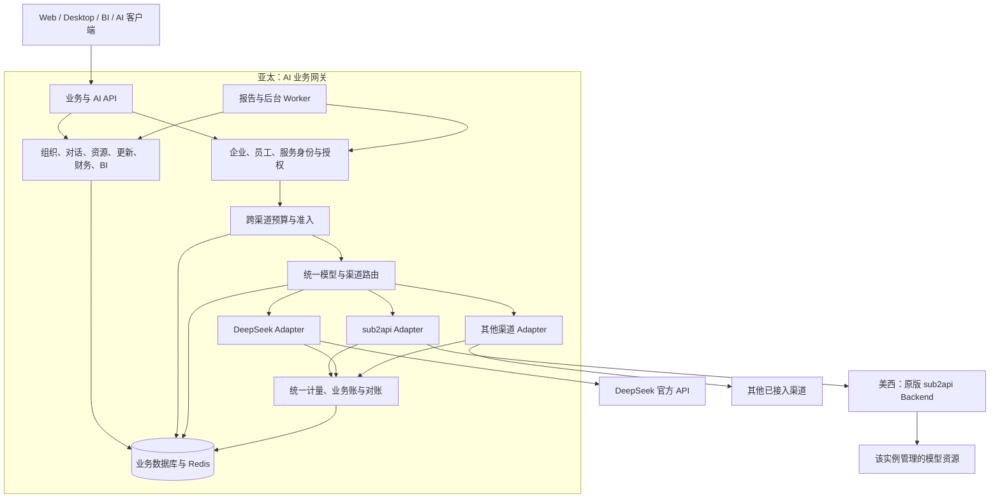
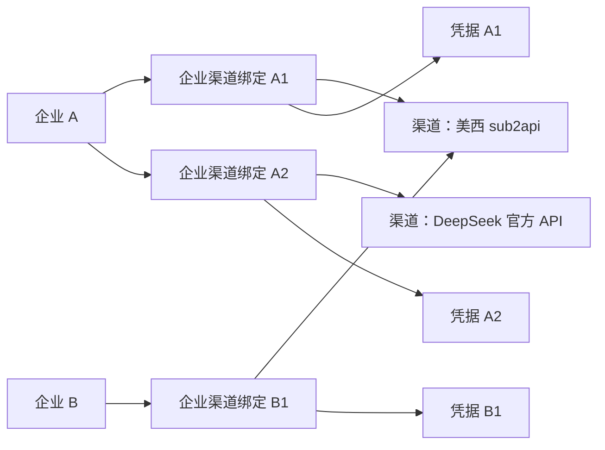

# 企业 AI 网关：从零建设与迭代方案

日期：2026-10-23。状态：技术设计，尚未实施。新项目的语言、框架和正式名称暂不限定。

目标是从零建设独立的企业 AI 网关，**完整保留当前项目的定制业务，并承接其必要依赖**。sub2api 原版中与定制业务无关的功能不纳入迁移。分阶段仅调整范围内业务的交付顺序，保留其角色入口、权限、数据、计量和恢复能力。业务平台部署在亚太；当前 sub2api 渠道部署在美西，使用原版 Backend 模式。DeepSeek 官方 API 和后续服务均作为可独立接入的渠道，不需要先接入 sub2api。

[定制业务与依赖清单](current-feature-preservation-2026-10-23.md) 包含 130 个定制业务条目、10 组必要依赖及工程检查，记录实现归属、数据／权限、验收要求和源码证据。原先 221 项是全仓能力盘点，不再作为必迁清单。新增发现按定制业务及具体依赖补录，不能把原版接口数量当成新项目范围。

原版 sub2api Backend 适合作为模型执行渠道；新平台承接定制业务所需的身份、权限、员工额度和计量。Backend Guard 关闭原版普通用户自助，不会因此要求新平台重建充值、套餐、退款或完整个人门户。C 系列定制订阅账号查看与额度操作仍由新入口提供。是否满足这些依赖，以选定原版版本和实际业务联调为准。

基础网关功能以 [QuantumNous/new-api](https://github.com/QuantumNous/new-api) 为参考，包括渠道、模型、令牌、路由、协议转换、额度结算、用量和运营管理。当前采用功能与机制参考的方式，尚未选择 fork、代码依赖或 new-api 运行实例；新项目的技术栈与独立企业模型仍按本方案决定。

企业可以绑定多个渠道。凭据约束定义为「一个企业—渠道绑定使用一份活动凭据」，允许保存轮换历史；员工和报告服务使用新平台自己的访问凭据。企业不关联上游用户，sub2api 内部必须存在的 Key 持有人仅属于该 Adapter 的管理配置。

本文区分当前源码事实、公开文档能力和待实施设计。当前 fork 基线为 `8de9d81614d68d680324973e5398f4da85a255bc`；sub2api 接口及 Key 持有人约束统一以原版 `v0.2.17` 的 `060d0160417782cd962a0c7f460f6cd4565d4916` 为基线。DeepSeek 能力依据本轮读取的官方文档，不表示已完成真实 API 或客户端联调。

new-api 参考源码固定为 `7fb6e57a5ff671582131c74e00bdfaa867d4e985`。功能核对、源码定位及与企业模型的差异见 [new-api 基础网关研究](new-api-gateway-reference-2026-10-23.md)，不将持续变化的 main 当作固定实现合同。

## 首版范围与迭代原则

产品定位为「企业统一管理 AI 接入、权限和用量的平台」。首版完成一条可实际使用的流程：创建企业与员工 → 绑定渠道 → 配置可用模型 → 签发平台凭据 → 客户端调用 → 查看用量与额度。

下面的首版范围用于内部验证或受控试点。后文保留完整目标、渠道差异和扩展约束，不将所有概念、表、接口和 new-api 功能同时列为首版任务。全部定制业务及其必要依赖属于最终交付范围；MVP 完成不代表定制业务全部迁移完成。原版无关功能不作为切换条件。

### 首版要交付的内容

| 范围 | 首版做法 |
| --- | --- |
| 企业与人员 | 企业、员工、状态；平台管理员、企业管理员、员工等固定角色，所有查询和操作落实企业隔离 |
| 渠道接入 | 支持企业绑定多个渠道配置；先打通原版 sub2api，人工录入已有渠道 Key；员工使用新平台凭据 |
| 模型与路由 | 企业可用模型清单和明确的模型映射；每个模型固定选择一个绑定，管理员可调整，不自动跨渠道重试 |
| 客户端调用 | 优先支持首批真实客户端需要的协议、流式和工具调用，通过渠道已支持的原生接口减少协议转换工作 |
| 用量与额度 | 保存请求身份、所选渠道、Token 与费用来源；企业总额度、员工和分析任务累计／窗口限额、预占及幂等结算；未知费用保留待核对状态；定制业务的额度合同是正式替换条件 |
| 管理页面 | 企业／员工、渠道／绑定、模型映射、平台凭据、用量与额度；配置表单使用独立路由 |
| 基础可靠性 | 凭据加密、日志脱敏、访问撤销、超时和取消、错误记录、持久化恢复；不能为缩小范围省略租户隔离或账务正确性 |

第一版不要求把全部协议都做成互相转换。WorkBuddy、Codex 等实际接入客户端需要哪些接口，就先完成哪些；若某客户端依赖 WebSocket、状态引用或特殊工具行为，这些能力必须在该客户端切换前验证，不能以普通聊天成功代替兼容验收。

多渠道关系从第一版建好，测试覆盖企业绑定多个渠道配置、企业之间的凭据隔离与跨绑定总额度。DeepSeek 的协议和计量差异先用于检查 Adapter 设计，真实接入安排在下一次明确迭代，不把两套完整 Adapter 同时上线设为首版条件。

### 初始部署和代码组织

默认采用模块化单体：一个应用、一个业务数据库，少量后台任务在同一应用内有界执行。代码按企业身份、渠道接入、模型调用、用量额度和业务功能组织，这些模块不对应独立服务。

后台恢复需要持久化时使用本地数据库任务记录，由应用定时领取执行。Redis 按实际缓存、会话或限流需要引入；多实例阶段必须统一限流计数，不能用各进程独立计数承诺全局限制。对象存储随附件和资源模块落地。

亚太应用连接美西 sub2api，两个系统各自使用本区域数据库。先限制后台任务并发并隔离连接池；只有报告等任务实际挤占转发资源时，才将同一代码库的 Worker 单独部署。技术栈在进入实现阶段时选择，本轮不预先限定。

### 为实际变化保留的扩展点

1. 渠道 Adapter：隐藏端点、认证、请求与响应差异；首版静态注册，后续按新渠道实际需要增加实现。
2. 模型与调用配置：保留稳定模型 ID、绑定 ID 和配置版本；试点先固定平台路由，已有 sub2api 内部调度和主备继续由渠道承接。新增跨渠道主备或权重时再扩展候选列表。
3. 用量映射：保留原始计量、来源、币种与确认状态，允许渠道采用响应 usage 或后台读取；不预先建立任意计价脚本系统。

只为已确认存在的差异定义接口；普通业务逻辑可以使用直接、清晰的实现，不要求每个类或 Repository 都有可替换框架。数据库模型按当前查询和约束落地，必要配置可先使用明确的结构化字段，不能把后文概念表机械转换成几十张首版表。

### 定制迁移、必要依赖与新增能力的边界

部门岗位、Desktop、对话、报告、BI、资源更新、企业财务、订阅账号扩展、Tibo、Key 数量限制、代登录、提示词采集和品牌入口逐项保留。身份、凭据、模型调用、计量、敏感操作认证和存储仅承接这些业务实际依赖的部分。

原版充值、套餐销售、退款、兑换与返利、完整个人门户、账号池／代理／插件运营后台等不迁入新平台。渠道自身的模型执行、内部调度和运维继续由原版提供，运营者可以使用原版后台维护；只有定制流程需要的动作通过 Adapter 暴露。

DeepSeek 等新增 Adapter、跨渠道自动主备／权重、新增定价规则和远端开户自动化按实际接入需要迭代。通用插件框架、通用工作流／规则引擎、跨区域双活和微服务拆分不作为初始建设内容。定制企业财务工作流继续保留，不因排除原版支付体系而缩减。

旧项目用于核对业务规则、客户端合同和复用已验证的测试样例。功能可以重新实现，数据导入与正式切换在相应新模块稳定后进行；未完成对应功能前，不把首版试点当作全量迁移完成，也不编造默认部门或岗位来补齐旧数据。

## 1. 产品职责与总体架构

新平台负责企业、员工及定制操作所需的本地账号、客户端接入、模型目录、跨渠道路由、协议校验、预算计量、对话报告、BI、企业财务和账号扩展。渠道负责模型执行及其内部账号管理，并提供定制业务实际需要的计量或管理接口。新平台的企业预算、费用归属与财务模块均不要求建设原版充值支付系统。

sub2api 在这里是聚合型渠道：选中它后，其内部账号调度、模型映射、协议处理和供应商故障切换仍由原版完成。DeepSeek 是直连渠道：新平台通过 DeepSeek Adapter 直接调用官方 API。平台决定使用哪个渠道，渠道内部的执行细节由对应 Adapter 隐藏。

图示为完整目标的逻辑分工。首版采用同一应用内的模块化实现，未进入当期范围的模块不提前建设；后续按真实负载决定是否独立运行 Worker。新增渠道的主要改动应集中在 Adapter 和必要的能力声明，业务 Handler 不直接增加供应商分支。

核心依赖方向为：业务模块 → 平台定义的模型调用与计量接口 → 路由模块 → 渠道 Adapter。领域模块不得导入 sub2api 的内部代码、表结构或管理 DTO；也不能把 DeepSeek 的响应结构直接变成平台通用账单。

### 1.1 以 new-api 为参考的基础功能范围

以下是 new-api 的功能机制参考，试点首版仅实现前述范围。最终范围由定制业务、明确依赖和已确认的企业网关需求决定。表中「参考」不表示全部必须建设，也不代表所有渠道支持；从原版或 new-api 找到类似能力本身不构成迁移理由。

| 基础能力 | new-api 的参考机制 | 新项目设计 |
| --- | --- | --- |
| 统一协议入口 | Chat、Responses、Messages、Gemini 等入口与 RelayKit 转换 | 保留统一平台地址，逐协议、逐转换路径验证能力，不把注册路径等同于实现完整 |
| 渠道管理 | 类型、端点、Key、模型、状态、优先级、权重、测试和高级配置 | 平台 Channel 配置与企业 binding／凭据分开；企业只使用已授权绑定 |
| 模型目录与映射 | 可用模型、请求模型到上游模型的映射、渠道候选索引 | 稳定逻辑模型 + 已验证能力；先完成授权与候选筛选，再应用该候选的上游模型映射 |
| 分组与资源范围 | Group 参与资源选择和计费倍率 | 可作为路由资源范围或服务等级的参考，组织、部门、岗位和企业权限独立建模 |
| 平台令牌 | 状态、额度、过期、模型限制、IP 限制与 Group 访问 | 员工／服务 Token 增加企业、用途和绑定范围；限制只能缩小已有企业权限 |
| 路由与分流 | 优先级、权重、重试、渠道亲和性和指定渠道 | 在企业获准候选内路由；有状态请求固定 binding；unknown 和已输出流不透明切换 |
| 价格与计量 | 输入／输出／缓存等计量、倍率、分层或表达式价格、日志 | 使用版本化价格与来源证据，分别记录渠道成本、业务收费与财务资金 |
| 额度生命周期 | 预扣、补扣、结算和退款 | 使用持久化跨渠道预占与幂等账本，崩溃和对账未知状态可恢复 |
| 健康与运营 | 渠道测试、自动停用／恢复、状态和错误记录 | 区分凭据、binding、端点及供应商故障，避免一家企业的凭据错误停用共享渠道 |
| 用量与审计 | 用量、错误、渠道信息及管理操作记录 | 增加企业、actor、purpose、Request／Attempt、证据状态与预算关联 |
| 管理工作台 | 渠道、模型、令牌、价格、日志的筛选和操作 | 使用平台管理员／企业管理员分权；创建、编辑和配置采用独立路由页面 |
| 媒体与异步任务 | 图片、音频及任务接口、插件扩展机制 | 仅按已接入定制客户端或新需求启用；不默认迁移完整媒体产品和插件框架 |

固定版本的 new-api 已有独立 sub2api 和 DeepSeek Adapter，这可直接参考其「聚合网关也是一种渠道」的组织方式。对于 Files、count tokens 等端点，必须核对真实路由和处理器，不能仅根据通用 API 形状承诺支持。

### 1.2 参考模型与本项目模型的映射

| new-api 概念 | 本项目对应设计 | 必须保留的区别 |
| --- | --- | --- |
| Channel 中的端点、模型与 Key | `channels` + `organization_channel_bindings` + `channel_credentials` | 公共服务配置不持有各企业共用的隐式凭据 |
| Group | 可选路由资源范围／服务等级 | 不是企业，也不是部门；分组名称不能成为租户权限凭证 |
| Ability 的 group × model × channel 索引 | 企业获准候选索引 | 选路索引不证明 tools、图像、状态恢复或 WS 能力，另有能力矩阵 |
| Token 关联用户与额度 | `client_credentials` 关联本地 actor、企业和权限 | 不要求企业或员工在任何供应商创建用户 |
| 渠道亲和性 | 会话与 `provider_objects` 固定 binding | 原对象不能因默认路由变化被发往其他企业或渠道 |
| Quota 与消费日志 | 预占、账本、计量记录及来源证据 | 日志不是唯一账本，退款也不能只依赖进程内状态 |

企业候选缓存至少区分企业、逻辑模型、操作及路由／能力版本；权限收紧时及时失效。不能直接复用只按 Group 与 Model 命中的共享候选缓存来判断企业可调用的渠道。

new-api 的实现供设计和测试参考：本项目固定自己的权重、预算和重试语义，并核对缓存与数据库路径一致性。将来若选择源码复用或引入 RelayKit，再单独固定依赖版本并落实其许可与来源要求；这不改变当前未限定技术栈的决定。

## 2. 领域模型与企业多渠道关系

### 2.1 术语

| 概念 | 含义 | 示例 |
| --- | --- | --- |
| Channel | 一个经过批准的上游服务接入实例，包含 Adapter 类型、端点与运行配置 | 美西 sub2api 实例、DeepSeek 官方 API |
| OrganizationChannelBinding | 企业获准使用某个渠道的关系，包含凭据、可用模型和附加限额 | 企业 A 绑定上述两个渠道 |
| ChannelCredential | 某次绑定使用的上游凭据及轮换版本 | sub2api 企业 Key、该企业用于 DeepSeek 的 API Key |
| LogicalModel | 新平台向客户端提供的稳定模型标识及能力合同 | 企业选定的编程模型或分析模型 |
| ChannelModel | 渠道中实际可请求的模型及能力 | 经过核对的上游模型 ID、协议与参数限制 |
| RoutePolicy | LogicalModel 如何选择企业已绑定渠道的规则 | 主渠道、获准备用渠道、用途和模型替代规则 |
| Request / Attempt | 一次客户端业务请求，以及它触发的一次或多次上游执行尝试 | 尝试的渠道、模型、费用和结果分别记录 |

平台的 Channel 不等同于 sub2api 内部的渠道表、Group 或供应商账号。sub2api 的 `group_id` 仅是其 Adapter 的配置。

### 2.2 关系与约束

同一个 Channel 可以服务多家企业，各企业使用独立绑定和凭据。默认不跨企业复用一份上游 Key。企业新增一个员工只增加本地身份、预算和访问凭据，不增加渠道账号或 Key。

同一企业在同一 Channel 默认只有一个活动绑定，每个绑定只有一份用于新请求的活动凭据；历史代次用于费用与对象追溯。需要连接同一供应商的不同独立账户或部署时，可以定义不同 Channel 实例，不用隐藏的额外 Key 绕过这一关系。

| 逻辑实体 | 关键内容 | 约束 |
| --- | --- | --- |
| `organizations / departments / positions / members` | 企业、部门、岗位、员工和归属历史 | 业务 ID 独立，不以供应商用户或 Group 表示组织 |
| `principals / client_credentials` | 本地账号／员工／服务身份、令牌状态、用途、过期、获准模型与附加限额 | 客户端只持有平台凭据；企业调用必须有可信企业归属，定制账号查看按本地授权 |
| `channels` | Adapter 类型、端点配置、区域、状态、能力版本 | 端点仅由平台授权人员维护；区域未知时不编造 |
| `organization_channel_bindings` | 企业、渠道、状态、允许模型、附加预算和限速 | 企业—渠道唯一，所有操作验证企业范围 |
| `channel_credentials` | binding、版本、secret 引用、状态、生效时间 | 明文仅在服务端解密；轮换不清空业务预算 |
| `adapter_binding_refs` | Adapter 自己的远端资源引用 | 如 sub2api Key ID；通用模型不要求所有渠道都有数字 `api_key_id` |
| `logical_models / channel_models` | 平台模型合同与渠道实际模型、能力和证据 | 精确映射与版本化，不用名称前缀推断等价 |
| `model_routes / route_candidates` | 企业、逻辑模型、候选 binding、优先级与替代策略 | 候选必须已授权并满足能力 |
| `price_rules / price_versions` | 渠道成本规则、业务价格、计量单位、币种与生效版本 | 已执行请求保存价格快照，成本与售价分开 |
| `channel_health / probe_results / audit_events` | 分层健康状态、探测结果、配置与安全操作记录 | 不把凭据错误升级成全渠道故障；敏感值脱敏 |
| `ai_requests / ai_attempts` | actor、purpose、模型、策略、渠道、凭据版本和执行状态 | 路由与实际执行分别留快照 |
| `provider_objects` | 平台对象句柄、渠道、binding、远端对象 ID、所有者 | 后续引用回到原渠道并验证权限 |
| `usage_records / usage_evidence` | 规范化计量和原始来源证据 | 多来源合并到同一费用事件，不重复计费 |
| `budget_accounts / budget_reservations / billing_ledger` | 企业、员工、用途与渠道预算；预占、结算与更正 | 跨渠道事务性准入，金额使用十进制定点 |
| `channel_operations / outbox_events / sync_cursors` | 开通、更新、撤销、对账进度及失败恢复 | 仅在渠道具备相应管理能力时派发远端任务 |

这是一份完整目标的逻辑概念清单，不是首版建表清单，也不能假定当前 fork 已存在这些表。首版只落地企业、人员与凭据、渠道绑定与模型配置、调用与用量、额度预占和必要审计。价格与路由先使用简单配置及版本；有状态对象只实现已启用协议必需的归属记录；通用运营、独立策略服务和未启用业务表后置。当前公开业务 ID、历史来源和合法组织归属应尽量保留。

### 2.3 定制账号与权限的最小边界

新平台需要本地管理员、企业负责人、财务角色，以及 C 系列订阅账号查看者等定制业务身份。保留其登录、状态、会话、代登录和资源授权；没有企业归属的账号查看者按显式本地绑定查询，不自动创建虚构企业，也不能访问任意企业数据。

企业模型调用使用企业 ChannelBinding、员工或服务身份及企业预算。本地账号与远端供应商订阅账号的可见关系仅服务于定制账号功能，不作为企业调用的上游用户映射，也不引入个人 ChannelBinding、个人钱包或双 owner 账本。

账号登录和敏感操作认证按定制流程实际使用的方式承接。原版全套注册、第三方登录、Passkey、TOTP 自助管理等不自动进入范围；如果定制操作依赖其中一种认证，则实现该路径的兼容或明确迁移，不扩展整套身份产品。

## 3. 模块与 Adapter 接口

### 3.1 平台拥有的模块

| Module | Interface 应提供的行为 | 不应泄露给调用方的细节 |
| --- | --- | --- |
| Identity / Organization | 解析主体、企业、岗位与授权，撤销访问 | 上游用户、管理员 JWT、供应商 Key |
| Model Registry | 查询企业可用模型及可满足的操作能力 | 供应商目录结构、别名重定向及探测差异 |
| Router | 为请求生成可解释、可审计的执行计划 | 优先级、健康状态与候选筛选实现 |
| Budget / Billing | 预占、确认、释放、调整及多维预算查询 | 各渠道计费格式、汇率与证据合并 |
| AI Gateway | 接收已支持的客户端协议，调用 Adapter 并返回流 | 上游认证、端点选择与错误差异 |
| Usage / Reconciliation | 保存计量证据、归属请求、对账及修正 | sub2api 分页游标、供应商账单格式 |
| Business Modules | Desktop、报告、BI、财务、资源与更新 | 具体渠道的 API 与凭据生命周期 |

### 3.2 最小推理接口与可选管理接口

每种推理 Adapter 至少实现三项行为：

1. `DescribeCapabilities`：声明操作、传输、参数与限制，附来源和验证状态。
2. `Prepare`：验证请求是否可表达，构造受控的上游请求；对不支持的语义明确报错。
3. `Execute`：执行一次已选定渠道的尝试，流式交付响应、关联 ID、计量证据和执行结果。

`Execute` 不能把完整 SSE 或二进制响应读入内存后返回，也不能自行跳到另一个企业绑定。是否重试和是否选择另一渠道由 Router 决定。

管理能力采用独立的可选 Interface，例如 `CredentialProvisioner`、`UsageReader`、`BalanceReader`、`AccountOperations`。只有实现和验证过的能力才开放 UI 与调用；没有远端开通 API 的渠道可以录入 Key，不要求伪实现用户创建、余额修改或 usage 列表。

通用请求采用「可信 RequestContext + 按操作类型的 payload + 受验证的扩展参数」，而非把全部请求强制压成 `messages`。AI 调用 Context 包含企业、actor、purpose、逻辑模型、预算与策略版本；定制账号管理使用独立的本地资源授权。客户端同名 Header 不能覆盖认证结果。

响应需要同时保留：原生协议事件、平台可识别的状态、上游关联信息和计量证据。相同协议可以尽量原样传输；协议转换属于 Adapter 的明确能力，必须验证工具调用、推理、图片、取消与终止事件，不以「能返回文本」作为等价标准。

首版静态注册实际使用的 sub2api Adapter。DeepSeek 的真实协议与计量差异用于检查接口是否过于专用，其实现随下一次接入迭代增加；不先编写大量空 Adapter。HTTP、SSE、凭据处理等基础代码在出现真实复用时提取，供应商逻辑留在各自模块。

协议转换重点参考 new-api 的 RelayKit 分工：协议数据建模和转换独立于 HTTP 收发、选路、鉴权和计费，并返回转换路径、质量与诊断。其工具损失策略提供 allow／safe／strict；本项目采用明确策略并验证状态、角色及其他关键语义，不能依赖默认允许损失来证明合同等价。相关来源见 [固定源码研究](new-api-gateway-reference-2026-10-23.md)。

`Prepare` 应返回最终准备发送的模型、参数、转换诊断和请求体可重放性；预算预占依据这个确定后的计划执行。`Execute` 不再悄悄更换模型或提高 Token 上限；必须调整时重新校验政策与预算。

## 4. 统一模型、协议与能力

有效能力由客户端合同、平台协议实现、Adapter 已验证能力、渠道当前模型能力及企业授权共同限定。`GET /models` 只能证明目录可读或某个模型 ID 存在，不能独立证明工具调用、图片、Responses 状态恢复或 WebSocket 可用。

下面列出的协议、媒体和状态对象用于描述不同渠道的能力边界，不是全部实现清单。必需范围由 WorkBuddy、Codex、报告与其他已确认定制流程的实际调用决定；未启用的操作保持不支持即可，不因原版存在接口而扩展产品。

| 能力维度 | 必须分别记录的内容 |
| --- | --- |
| 操作 | Chat Completions、Responses、Messages、Embedding、Image、Audio 等 |
| 传输 | 非流式 HTTP、SSE、WebSocket、异步任务 |
| 输入与输出 | 文本、图片、音频、文件；输出类型和限制 |
| 对话行为 | tools、并行工具、structured output、角色语义、reasoning |
| 状态 | `previous_response_id`、持久化对象、缓存、后台执行、续写 |
| 计量与价格 | usage 来源、缓存／推理 Token 定义、计费单位、币种、价格版本 |
| 管理 | Key 开通／撤销、远端额度、账户余额、历史 usage 与账单读取 |

能力至少区分 `declared`、`verified`、`unsupported`、`unknown`。关键能力为 unknown 时不参与对应路由；模型能力变化使已有合同不再成立时，阻止受影响调用并更新能力版本。

平台模型名保持稳定，执行记录同时保存 `logical_model_id`、请求的上游模型、响应声明的模型、channel 和 binding。响应未声明模型时保持未知，不推断渠道内部实际运行的模型版本。上游可能将旧模型别名转向新模型，不能将字符串相同当成语义与价格不变。

对客户明确指定的模型，默认不替换为其他模型。业务别名如「企业分析模型」可以配置允许的替代集合，但须明确模型差异与价格，不能只因为都兼容某个 API 就互为备用。

| 例子 | 允许的路由 | 约束 |
| --- | --- | --- |
| 编程模型，使用 Responses + 已保存 response 引用 | 仅满足该状态能力的绑定 | 无状态 Responses 渠道不参与这次续写 |
| 企业分析模型，完整输入的非流式请求 | 已授权且满足模型／能力策略的 sub2api 或 DeepSeek 绑定 | 固定执行时的实际模型、价格与路由版本 |
| 明确指定某供应商模型 | 该模型经过验证的候选渠道 | 不自动改成另一供应商模型 |
| 需要图像生成的请求 | 已验证 Image 操作的绑定 | 不能投给只支持文本或图像理解的模型 |

Desktop Model Configuration 继续返回新平台 Base URL 与平台 Model Token；模型列表由平台按企业授权生成。增加或切换渠道通常不需要向客户端分发新上游 Key；涉及客户端协议能力变化时仍需明确升级与联调。

## 5. 渠道路由与故障切换

### 5.1 一次请求如何选择渠道

1. 验证平台凭据，解析企业、actor、purpose、模型合同与资源访问范围。
2. 如请求引用已有会话或对象，读取原渠道绑定；有状态对象不能按当前默认路由重新选择。
3. 从企业已启用的绑定中筛选候选，核对凭据、模型能力、参数、附加限额和企业允许的传输地域。
4. 按已发布策略选择候选，执行 Adapter `Prepare`，校验最终模型、参数和转换诊断，形成策略、能力与价格快照。
5. 在亚太本地事务中核对最新授权与 binding 状态，预占企业及适用的员工／用途／渠道预算，保存执行计划并创建 Attempt。
6. Adapter 执行已冻结的计划，实时交付响应并保存关联、对象和计量证据。
7. 对 Attempt 分类为成功、明确未执行、部分执行或结果未知，按规则结算和恢复。

首版每个企业模型固定映射到一个获准 binding，不启用自动备用候选或权重分流。一个企业仍可把不同模型映射到不同渠道。管理员改配置后影响新请求，已有对象继续使用原绑定。

新增跨渠道主备与分流时，再扩展优先级和候选列表：优先级高的可用候选先参与，同一优先级内按正整数权重选择，默认权重 1，停用通过状态表达。届时缓存与数据库采用相同规则，并避免重试在候选间循环。sub2api 内部调度继续由原版处理，只验证其对定制会话连续性、错误和费用的影响，不移植其完整调度配置界面。基于成本、延迟或负载的自动优化需要真实观测后再设计。

新增 binding 不等于自动获得流量：还需通过连通性与能力验证、企业授权和路由发布。企业管理员只能选择已获准的渠道与模型；平台管理者维护端点和适配配置。所有创建、编辑、绑定及路由配置均使用独立页面。

试点首版先提供模型映射和 Adapter 内确定的参数处理。只承接影响定制客户端的 Header／参数与错误合同；渠道特有配置可在原版后台维护，不另建通用覆盖编辑器。配置不能覆盖平台解析的企业、actor、凭据或任意跳转目标；影响平台路由和费用判断的改写纳入 `Prepare` 的计划。错误展示映射不改变内部执行和计费状态。

### 5.2 失败分类决定能否切换

| 失败场景 | 行为 |
| --- | --- |
| 本地鉴权、企业授权、总预算或内容准入拒绝 | 直接拒绝，不通过换渠道绕过限制 |
| 连接未建立且能够确认请求没有发出 | 可选择同一授权策略内的下一个候选 |
| 渠道返回经 Adapter 证实未接受执行的拒绝 | 按原因与策略决定是否切换；不能只看 HTTP 状态码 |
| 请求可能已被接受，但超时或响应 Header 丢失 | 记录 unknown，保留相应预占，默认不自动换渠道 |
| SSE／WS 已产生输出 | 不拼接另一个渠道的输出伪装为同一次回答，按原协议结束或报错 |
| 有状态续写或任务查询的原渠道不可用 | 等待原渠道恢复或明确开启新任务，不能把其对象 ID 发给另一渠道 |
| 供应商 Key 失效或某企业渠道额度不足 | 隔离该 binding；不要直接熔断整个供应商或其他企业 |
| 确认为渠道端点整体故障 | 渠道级熔断并有限探测恢复；其他获准渠道继续工作 |

「尚未返回首 Token」不等于「上游未执行」。不默认进行并发生成或 hedge 请求。发生新 Attempt 时，分别记录其预占、费用和结果，成功回答不能掩盖此前已经发生的成本。

平台限制自己发起的渠道尝试次数与总 deadline。sub2api 的内部重试由该渠道管理，不能声称平台看到了或限制了所有内部账号尝试；应核对其超时策略，避免两层重试放大成本和延迟。

客户端 SDK 的自动重试也需验证。提供稳定幂等标识的请求关联到同一个平台 Request；此前结果仍未知时不能重新派发生成。没有稳定标识时不能保证去重，也不能用正文 hash 合并用户合法的重复提问。流式重连不等于可恢复已经输出的全部内容，不承诺外部调用 exactly-once。

请求体能否安全重放属于 Adapter 的准备结果，无法重放的上传流不能自动切换候选。健康探测优先采用无费用接口和真实请求结果；需要生成模型内容的探测使用明确的测试预算与费用归属。

### 5.3 模型和会话连续性

会话路由保存 binding、请求模型与必要的远端对象信息。请求带有 `previous_response_id`、缓存、文件、媒体任务等引用时，先执行对象归属和路由绑定检查。模型或协议不能满足续写能力时返回明确错误，不静默丢弃状态参数。一个请求引用多个渠道的专属对象时，默认拒绝混用；跨渠道迁移或重新上传必须是明确实现并获准的操作。

无状态全量上下文请求可以按照企业策略路由，但跨模型替代必须被显式允许。报告分块默认固定一次生成所选的模型和渠道；模型、提示词或关键参数改变时建立新的生成版本，不能无条件复用旧 checkpoint。

## 6. 渠道凭据、管理能力与一致性

平台访问凭据和供应商凭据完全分开。客户端持有的平台 Model Token 可使用其企业获准的多个渠道；token 本身不绑定某个供应商明文 Key。

| 凭据 | 使用范围 |
| --- | --- |
| Web / Desktop / BI 会话 | 相应业务 API |
| 员工／服务 Model Token | 新平台 AI 入口，解析可信 actor 和 purpose |
| 企业渠道凭据 | 指定 binding 的推理调用，服务端加密保存 |
| 渠道管理凭据 | 仅供有管理能力的 Adapter 使用，不参与普通模型转发 |

### 6.1 平台令牌的基础权限

平台令牌保留定制流程需要的主体、企业与用途、状态、模型授权、创建数量限制、托管用途保护、轮换撤销、员工累计与窗口限额，以及客户端配置所需字段。原版 IP allow／deny、额外分组权限或高级管理能力，仅在定制授权实际依赖或明确新增需求时接入；不能把整个原版 Key 产品都作为前置条件。采用明确固定规则，不建设任意权限表达式系统。

有效权限取企业授权、actor 权限、令牌限制与路由绑定权限的交集。令牌中的「不限额」只表示没有该层附加额度，不能跳过企业总预算。显式渠道提示或指定模型也必须经过相同校验。

验证使用摘要；旧 Model Configuration 合同确需重复下发平台 Token 时，另存受控密文并限定解密入口。轮换、撤销和数量限制在本地完成，不重新创建供应商用户或员工级上游 Key。

### 6.2 渠道凭据的一致性

首版采用手动录入与校验已有渠道 Key，企业和员工开户不依赖远端开户。企业可以先创建，binding 未就绪时不获得该渠道调用权；本地撤销始终有效，远端 Key 的运维管理有明确操作者。后续需要自动开通、轮换或远端撤销时，再接入渠道提供的管理接口。

首版 binding 使用待校验、启用、停用等必要状态。引入远端写操作后，使用本地事务与数据库任务记录实现 Outbox，按实际错误增加待重试或重新认证状态；固定操作 ID、幂等键、远端回读和版本校验用于恢复。不在没有对应远端流程时预先实现全部状态机。

员工停用撤销平台凭据，不影响同企业其他员工。停用一个 binding 只禁止该渠道；停用企业则停止全部 binding 的新准入，再根据各 Adapter 能力处理远端撤销。部分供应商不支持自动撤销时，也必须保证平台本地撤销即时生效。

凭据轮换保留旧代次、历史用量与对象归属，不重置企业预算。已绑定旧代次的异步任务需要排空、归档或验证供应商支持的迁移方式。轮换不应通过清空历史计量完成。

在供应商缺少原子版本条件的情况下，平台只承诺本地策略一致和远端最终核对，不宣称跨系统事务。对同一 binding 串行派发写入，结果未知时暂停继续放宽额度。

## 7. 统一计量、成本证据和业务计费

### 7.1 平台拥有统一账本

sub2api usage logs 是该渠道的计量来源，不能作为所有渠道的账本。DeepSeek 等渠道可能主要在生成响应中返回 usage，是否提供历史明细和管理 API 必须单独验证。

每条记录至少保留企业、actor、purpose、Request、Attempt、binding、凭据代次、逻辑／实际模型、原始计量、标准化口径、成本币种、价格版本、来源和确认状态。

| 证据 | 能证明的内容 | 限制 |
| --- | --- | --- |
| 模型响应中的 usage | 本次响应报告的 Token 或其他计量 | 不天然证明最终货币账单；断流可能没有完整 usage |
| 渠道明细 API | 渠道按其口径记录的用量和金额 | 可能延迟、修正；需要来源去重和请求关联 |
| 版本化价格计算 | 按指定规则估算或计算的渠道成本 | 不是供应商已确认扣款，需显示依据 |
| 供应商账单或结算文件 | 对应周期的账务金额 | 汇总账单不能自动分解为每个员工的精确费用 |
| 本平台业务价格规则 | 对客户应收的业务金额 | 与渠道成本、平台技术余额及财务收款分别记录 |

分别维护 `usage_status`、`channel_cost_status` 和 `business_charge_status`。例如 Token 已确认、渠道成本按价格计算、客户应收按合同确认，可以同时成立；不能用一个布尔值把三者混成「已结算」。

sub2api 的 `actual_cost` 按其计费类型与规则解释，记录为渠道计量金额；不直接宣称它就是最终供应商现金成本。平台不修改上游余额来重复执行每笔消费。失败 Attempt 的渠道成本与是否向客户收费分别遵循业务规则。

### 7.2 计量口径与价格

保留原始供应商字段，再按明确版本映射。缓存命中 Token、缓存写入 Token、推理 Token 可能是其他总量的子集，不能直接将所有数字相加。图像、音频、时长、工具和异步任务按各自单位记录。

原始金额保存币种和十进制精度；不同币种不直接相加。经营报表如需统一币种，保存采用的汇率来源、时点和计算结果。价格规则带生效区间、模型／服务等级与版本，每次 Attempt 使用快照；供应商改价或别名切换不重算已确认历史。

有响应 usage 但没有权威金额时，可生成明确标记的 calculated cost；连 usage 都缺失时保持 pending／unknown，不能填零。若业务收费必须依赖供应商最终金额，则保持待确认；按独立合同价格收费时，仍保留渠道成本的不确定状态。

### 7.3 证据合并与请求归属

先持久化可信 actor 与 Attempt，再发送请求。不同渠道的关联 ID 由 Adapter 提取：响应 ID、返回 Header、远端 usage ID 或任务 ID。不能要求所有渠道接受或回显同一个自定义 Header。

`usage_evidence` 保存多个来源；`usage_records` 表示经过合并的一次计量或收费事件。响应 usage、后到的渠道明细和账单不能各扣一次费。Adapter 定义稳定来源定位规则，源事实更正以修订和差额记账，保留历史。

去重键必须包含渠道实例及适当的凭据／来源范围；上游数字 ID 或 response ID 不保证跨渠道唯一。平台还需区分一次 Request 中的多次 Attempt，以及一个 Attempt 中多个合法收费项。

共享企业渠道 Key 只能直接证明企业归属。未能关联到平台请求的来源记录记为 `unattributed`，不能平均分配给员工或默认算成分析费用。跨渠道统计按同一成本口径核对：

企业总费用 = 已归属员工费用 + 已归属分析／服务费用 + 未归属费用。

`unattributed` 是恢复状态，不能作为永久丢失定制员工统计的验收豁免。正式切换前对实际使用的 HTTP、SSE、WS 和报告等调用验证发送前身份、响应关联与后到明细恢复，包括响应全部丢失和进程重启。定制流程原本能精确归属的场景仍须达到同等结果；无关的原版媒体协议不因此进入范围。费用未知时继续保留 unknown，不补零。

亚太侧 BI 和 CSV 读取统一账本，显示统计时区、数据截止时间和各渠道完整性。任一渠道无数据，不得解释为该渠道零消耗。

## 8. 跨渠道预算和额度控制

企业预算由新平台统一执行，覆盖所有渠道、员工和报告。渠道原生额度只是附加保护；给两个渠道分别设置 100 的额度，不能证明企业总额度只有 100。

本节的结算与退款指模型调用额度的确认、差额退回及预占释放，不包含充值订单或支付渠道退款流程。

一次准入在业务数据库内原子检查企业、员工／用途及可选渠道子预算，并建立预占。并发访问不同渠道时仍使用同一企业预算账户。示例：企业剩余 100，两条并发请求各需要预占 60，不能都通过检查。

参考 new-api 的预扣、结算和退款生命周期，但本项目不因账户余额较高而跳过实际企业预算预占。确认为零费用时可以预占零金额，仍保存请求与预算判断；多维额度检查不代表重复收取多笔业务费用。

预算判断包含已确认支出和待结算预占。成功取得计量后幂等确认、调整并释放相应预占；明确未被执行的请求可以释放；上游结果未知时保留待确认，不能仅凭超时自动释放。

预占、结算、退款意图和修正事件持久化并使用幂等键。退款可异步执行，但先写入可恢复的任务，不能只依赖进程内 goroutine 或内存标记；重启后继续处理待确认与待退款操作。

WebSocket 按每次生成 turn 准入；异步媒体保持任务级预占。需要新的 Attempt 时重新检查可用预算。预占和授权所需的请求身份保存失败时，不发送请求。

如果无法证明生成、工具或媒体任务的费用上界，预占只能提供估计控制，不能承诺严格零超支。保留「在途请求可能超过阈值」的明确语义；需要严格上限时，只接受能够限定最大费用的能力和参数。未知费用积压超过配置阈值时，暂停新增请求并恢复对账。

企业追加余额或额度写入本地业务账；是否同步某渠道的原生 quota，由其管理能力和企业渠道策略决定。不把全部企业余额复制到每个渠道后依赖上游分别检查，也不因更换渠道、凭据或默认模型重置企业累计支出。

并发和 RPM 同样分别按企业、员工、binding 和渠道共享容量控制。供应商的账户余额属于运行条件，不能作为企业剩余额度返回给客户。

## 9. 资源权限、对话和业务模块

共享上游凭据意味着渠道看不到真实员工。平台需要保存 response、session、file、cache、batch、voice、媒体 task 等对象的渠道、binding、远端 ID、凭据版本与本地主体关系。后续引用、读取、列表、下载、取消和删除都验证这些关系。

统一协议能提供平台对象句柄时，由 Adapter 映射远端引用；原生协议保留供应商 ID 时，必须结合会话和已记录的渠道关系确定唯一归属。发生 ID 冲突或归属未知时拒绝操作，不猜测目标渠道。列表也不能原样返回供应商账户或共享 Key 可见的全部对象。

已有对象保持原渠道绑定；更换企业默认渠道只影响允许重新选择的新请求。对象所属渠道被停用后，按本地授权和归档策略处理，不能让引用对象触发未获准的其他渠道调用。

对话上报与模型提示词快照继续分开。对话按客户端合同保存来源、时长、截断和缺失信息；提示词提取只处理保存的副本，不修改上游请求。报告服务通过本地可信身份确定 `purpose=analysis`，不依赖供应商 Key 的名称或客户端任意 Header。

现有 direct conversation 路由缺少调用方认证，新平台增加绑定企业范围的凭据或签名、防重放和归属校验。原始公开 ID 不能作为认证依据。[F8]

定制提示词采集、隐私开关、用途排除、正文查看权限及相关操作审计在平台按真实 actor 实施。无需为此重建原版完整 Content moderation 或 Prompt audit 产品。渠道启用自身风控时仍须核对共享技术持有人、亚太出口对定制流量的影响；一名员工的违规不能被平台误记为另一主体。已启用对象操作按本地所有者授权。

报告 Worker 只调用平台模型接口，使用企业配置的逻辑模型和路由。保留来源快照、lease、退避、分块和 checkpoint；数据库读取批次与最终模型调用批次分别控制。已经确认成功的分块不因网络故障重做；新模型或新生成版本不能无条件重用旧输出。[F5][F9]

财务订单、收付款、VCC、合同、发票、成本分摊、对账、关账和附件仍由独立业务模块处理。渠道成本、业务收费、客户到账与供应商发票是不同记录，不能因新增渠道就混合账务口径。

## 10. 亚太部署与各渠道的网络路径

首版应用及业务数据库放在亚太，业务 API、模型转发和后台任务默认在同一应用内运行；后续增加报告 Worker 或选用 Redis 时，也优先部署在亚太。sub2api 实例及其数据库、Redis 继续在美西。接入 DeepSeek 后直连走「亚太 → 官方端点」，不会经美西 sub2api 绕行；官方端点实际处理地域以服务约定和测量为准，不由品牌名称推断。

| 调用类型 | 路径与处理 |
| --- | --- |
| 组织、人员、财务、BI、已有报告 | 客户端 → 亚太业务 API → 亚太业务数据 |
| 选择 sub2api 的推理请求 | 客户端 → 亚太网关 → 美西 sub2api → 其模型资源 |
| 选择 DeepSeek 的推理请求 | 客户端 → 亚太网关 → DeepSeek 官方 API |
| Key 管理与同步 | 对应 Adapter 的后台任务，不进入每次推理的前置远程查询 |
| 渠道对账 | 各 Adapter 提供的来源 → 亚太统一账本；缺少来源的渠道保持明确的证据状态 |

连接池、最大并发、队列、熔断和超时按渠道及流量类别隔离。历史对账和报告不能占满交互式请求的容量；单个渠道故障不拖住其他渠道和普通业务页面。

美西自建入口可采用 HTTPS + mTLS 和出口访问控制，由反向代理实现而不修改原版。第三方 SaaS 使用其支持的 HTTPS 和认证机制，不要求所有供应商实现私网或 mTLS。渠道端点只能来自批准配置，重定向、DNS 变化与凭据转发都受控，客户端不能传任意上游 URL。

复用 HTTP 连接；HTTP/2、WebSocket Upgrade、SSE flush、压缩和 idle timeout 逐渠道验证。区分建连、TLS、首响应、读空闲和总时长；不使用统一的短业务超时中断长推理。每个 Token 不需要新发一个跨区域请求，但多轮 Agent 调用、大上下文和媒体传输会叠加网络开销。

sub2api 管理会话可能启用 IP／User-Agent 绑定，Adapter 统一刷新并维持稳定管理出口；更换出口按实际策略重新认证。其持有人级容量与面板限流是该渠道的共享条件，不成为整个业务平台的统一身份模型。[U9]

| 故障 | 处理 |
| --- | --- |
| 某个渠道或线路不可用 | 按第 5 节选择获准且满足能力的候选，不能无条件换模型；无合适候选则返回明确不可用 |
| 管理认证不可用但推理 Key 有效 | 已授权推理可继续；对应渠道的新开通与远端额度操作排队 |
| 某渠道对账滞后 | 显示该渠道的缺口并保留预算预占；不把总账显示为完整 |
| 亚太身份／预算存储不可用 | 停止新增模型准入，客户端不绕过平台直连供应商 |
| 推理已发出但返回中断 | 保留 unknown Attempt，依该渠道可用证据恢复，不自动释放费用或重新生成 |

所有时间保存 UTC，业务日界使用明确时区。网络恢复后先核对未知 Attempt、费用和预算，再恢复受限制的队列。当前尚无实际亚太出口与各渠道端点的网络测量，不给出固定延迟或 SLA。

## 11. 首批渠道的具体适配

### 11.1 sub2api Adapter

当前美西 sub2api 采用原版 Backend 模式。每个企业绑定该实例时使用一份独立模型 Key；企业不创建或关联 sub2api 用户。原版 Key 的 `user_id` 是必填项，统一持有人仅保存在该渠道的管理配置中。[U8]

Backend 是关闭普通用户自助的运行设置，不会自动提供企业身份或接收员工授权。新平台仅承接定制身份、权限和业务入口；原版用户门户、支付与套餐并非迁移依赖。定制账号操作经管理 API 代理时记录真实平台操作者。技术持有人的余额、并发和封禁可影响多个绑定，应作为渠道运行条件监控，不能承担企业业务账户职责。

| 能力 | 当前已核实的原版实现 | 在 Adapter 中的处理 |
| --- | --- | --- |
| 模型调用 | Chat、Responses、Messages、Gemini 原生及其他已注册路径 | 按实例 Group、平台、模型及传输能力验证，不能仅凭存在路由宣称可用 |
| Key 开通／更新 | `POST /api/v1/keys`、`PUT /api/v1/keys/{id}` | 使用持有人管理员 JWT，Backend guard 放行 admin；普通员工流程不使用此 JWT |
| 管理认证 | Admin API Key 或管理员 JWT；Key 自助路由使用 JWT | 分开保存和使用，Admin API Key 不能代替所有路由的 JWT |
| 模型分组 | Key 绑定 Group，可能使用 Composite Group | 远端 Group ID 留在 Adapter 配置，不成为平台组织或通用路由实体 |
| 原生配额 | Key 累计、5h／1d／7d 窗口及过期 | 作为该 binding 附加保护，不替代平台跨渠道预算 |
| 用量来源 | `GET /api/v1/admin/usage` 与 `/stats` | 按远端 Key 和日期分区，分页、重扫、去重和核对 |
| 个人订阅账号扩展 | 当前 fork 的绑定、安全投影、只读 usage 与刷新规则不等于原版完整提供 | 按 C-004～C-009 在本地保存绑定和安全快照；原版可用操作经受控管理 API 执行，不存在的能力登记阻断；其他渠道可不支持，但现有功能必须保留 |

Key 创建固定操作 ID 和幂等键，结果未知时回读核对。平台持有人的技术余额和并发属于该渠道容量，不能用来识别企业或作为企业业务余额。[U1][U2][U3]

单个上游 Key 绑定一个 Group。仅检查定制客户端与报告实际需要的模型／资源组合，验证能否由一个获准 Group、Composite 和明确映射表达；原版其他多组使用场景不纳入。禁止逐请求改写共享 Key 的 Group，也不以隐藏额外 Key 绕过“一企业—渠道一份活动凭据”。无法表达定制需求的组合才记录为切换阻断。[U3]

用量同步没有核实到稳定 CDC 游标或本方案可用的 webhook。采用 Key／日期分区、稳定排序、分页提交、近期重扫和更早分区对账；并发写入与迟到记录使单轮成功不等于完整。日志保留期必须覆盖故障恢复和重扫窗口。[U4]

原版会生成并返回自己的 `X-Client-Request-ID`，常规计费可能使用 `client:<id>`；WebSocket 和媒体另有规则。Adapter 根据经过验证的规则关联 Attempt，不假设发送同名 Header 就能控制费用 ID。响应 Header 全丢失时，此方法不能独自恢复员工归属。[U6]

原版已有显式会话 Header → `usage_logs.session_id` 的持久化路径。可优先验证“平台生成并持久化可信会话映射，再经原版管理 API 回读”的恢复方式；保留客户端原会话语义并隔离企业／员工，不能把同一员工的全部请求强制合为一个会话。该字段只能在已验证范围内证明 actor，不天然证明唯一 Attempt；同会话并发仍需请求或对象关联。Header 可能被其他调度／缓存代码使用，不能随意逐请求改写。定制调用涉及的协议、WS、回读字段和内部重试仍待联调，尚未证明恢复闭合；无法恢复定制统计时阻断相应切换。[U10]

当前 fork 在协议、HTTP/2、TTFT、依赖安全等位置还有原版 Release 差异。选择原版版本时回归定制调用实际依赖的修复，不把全部 fork 工程差异当成迁移模块。平台或 Adapter 能等价补齐的在本地实现；无法补齐且影响定制流程时选择已修复的原版版本，未解决前保留对应旧流量。

### 11.2 DeepSeek Adapter

本轮已读取官方首页、Chat Completions、Responses、Anthropic 兼容说明和余额接口。以下是文档事实，不是运行验证：

| 文档能力 | 对 Adapter 的要求 |
| --- | --- |
| OpenAI 格式 Chat Completions | 使用已验证的模型、参数和 HTTP／SSE 合同 |
| Responses 格式 | 已有官方支持，但不能视为完整 OpenAI Responses 等价实现 |
| Anthropic 格式 | 有官方兼容入口，需逐字段处理其支持、忽略和映射行为 |
| 响应 usage | 作为计量证据提取；与货币账单确认分开 |
| 余额读取 | 可作为账户运行状态；不能直接代表企业或某 Key 的独立预算 |
| 自动创建 Key、可完整回补的逐请求历史账单 | 本轮未验证，首期不把它们设为接入前提 |

Responses 官方说明明确为无状态接口，不支持 `previous_response_id`、`conversation`、`store`、`background` 等能力；部分不支持的参数会被静默忽略，且 `developer` role 存在语义映射。对状态恢复、身份层级或其他必要语义，新平台必须预先校验并拒绝不满足的候选，不能任由上游忽略后仍声称合同满足。WebSocket 等本轮未验证能力保持 unknown。[D2]

Chat Completions 文档说明：流结束前的最后一个内容 chunk 携带 usage，并不产生单独的空 choices usage chunk。计量提取不能复用「只在空 choices chunk 读 usage」的假设；中断而缺少末尾计量时保持未知。[D1]

文档中 `prompt_tokens` 已包含缓存命中与未命中部分，不能再把 `prompt_cache_hit_tokens` 加到输入总数。实际字段仍按所用协议分别映射，保留原始 usage。[D1]

Anthropic 兼容文档存在将部分 Claude 名称映射为 DeepSeek 模型的行为。平台发送明确的 DeepSeek 上游模型 ID，并记录实际模型；不能向用户宣称在调用 Claude 而实际运行另一个模型。[D3]

供应商余额文档列出不同币种的余额项。平台不通过余额差值推断某个并发请求的精确费用，也不把供应商账户余额直接复制成企业钱包。[D4]

官方模型别名和能力会变化。目录、价格与能力声明带采集时间和版本，不把文档中的当前模型名、上下文上限或价格永久硬编码进通用模块。接入后必须完成正常、工具、推理、流式、断流和计量合同测试。

### 11.3 新增渠道的完成条件

新增渠道需要提供：批准的端点与认证方式、模型和能力声明、推理 Adapter、错误与执行确定性分类、计量映射、价格来源，以及其确实支持的管理能力。完成合同与真实请求验证后，再允许企业绑定和路由发布。

只填写 Base URL 与 API Key，不足以完成一个渠道的产品接入。实现可复用同协议基础代码，但协议兼容、业务能力、计量和运营能力必须分别验证。

## 12. 定制业务及必要依赖的迁移归属

范围以 [定制业务与依赖清单](current-feature-preservation-2026-10-23.md) 为准，130 项定制业务完整保留，原版能力按 R-001～R-010 的依赖切片承接。下表仅展示模块分工。

| 当前能力 | 新项目归属 | 渠道依赖 |
| --- | --- | --- |
| 企业、部门、岗位、员工、调岗、导入 | 组织与身份模块 | 无供应商用户关联，保留真实归属历史 |
| Desktop v1/v2 会话、安装绑定、模型配置 | 客户端模块与平台凭据 | 统一模型目录，配置指向新平台 |
| MCP／Skill 资源、Desktop 更新与企业灰度 | 资源与发布模块 | 独立存储、版本、校验和下载授权 |
| 对话、提示词快照、来源与时长 | 对话模块 | 原始采集与实际模型渠道分别记录 |
| 日报、日总结、周月总结 | 报告模块 | 调用平台逻辑模型，渠道可由策略选择 |
| 企业、员工、模型、客户端用量与 CSV | 统一计量和 BI | 跨渠道口径与证据状态 |
| 微信身份、邀请、企业授权、运营与隐私配置 | BI 模块 | 不要求渠道实现微信或业务身份 |
| 订单、合同、票据、收付款、VCC、成本分摊、对账月结 | 财务模块 | 渠道成本为来源之一，账务流程本地独立 |
| 个人订阅账号视图、状态与额度操作 | 渠道运营扩展 | 当前迁入 sub2api 扩展，通用渠道接口不承诺这些能力 |
| Tibo 监控 | 独立外部数据 Adapter | 不属于模型渠道核心合同 |
| API 凭据数量限制、代登录、品牌与入口 | 平台身份、安全和产品模块 | 原版工程差异不直接成为平台业务能力 |
| 定制客户端与报告所需协议、模型发现和 usage | 平台协议入口、计量与渠道执行 | 按实际客户端合同验证；不默认开放原版全部媒体／实时产品 |
| 定制 Web 身份、会话、敏感操作认证与审计 | 平台本地身份及安全模块 | 仅承接定制角色和认证路径，不扩展完整个人门户 |
| 必要渠道 Key、模型／Group 与账号操作 | Adapter 与原版管理 API | 普通业务依赖留在平台，完整渠道运营留在原版后台 |
| 业务预算、历史费用和原始计量 | 平台预算与计量模块 | 不包含原版充值、套餐销售、退款、兑换或返利体系 |
| 定制日志、文件、任务恢复、备份和交付 | 平台运行与工程能力 | 根据新平台实际负载与技术栈实现，不复制原版全套 Ops 和更新后台 |

当前组织结构已经落到代码；BI 当前采用独立微信身份加 Desktop 数据读取，旧通用 Connector 和事实导入已退役。本次迁移不恢复旧实现，也不把尚未完成的知识库、通用成果和 SOP 计入现有功能。[F1][F2][F3]

敏感字段迁移保留加密算法、密钥版本及指纹唯一性。财务、个人账号和运维接口使用白名单 DTO；供应商 Key、OAuth 凭据和管理员响应不得直接返回客户端。

## 13. 管理 API、兼容与迁移

### 13.1 管理入口建议

以下为新接口草案，最终由 OpenAPI 固化；现有已使用的 Desktop／BI／财务路径继续由兼容 Handler 承接。

| 路径示意 | 用途 |
| --- | --- |
| `/api/platform/v1/channels` | 平台渠道目录、端点、Adapter 与能力状态 |
| `/api/platform/v1/channels/{id}/probe-runs` | 有授权与预算的渠道测试、诊断及恢复记录 |
| `/api/platform/v1/logical-models` | 平台模型目录、能力合同、映射与版本 |
| `/api/platform/v1/price-rules` | 渠道成本与业务价格规则、版本及生效时间 |
| `/api/platform/v1/organizations/{id}/channel-bindings` | 企业绑定、凭据、附加限额与停用 |
| `/api/platform/v1/organizations/{id}/client-credentials` | 平台访问凭据与模型、IP、额度等限制，按操作者权限裁剪 |
| `/api/platform/v1/organizations/{id}/model-routes` | 逻辑模型候选、优先级、替代范围及策略发布 |
| `/api/platform/v1/organizations/{id}/budgets` | 企业、员工、分析及渠道子预算 |
| `/api/platform/v1/organizations/{id}/usage` | 跨渠道用量、费用和数据完整性 |
| `/api/platform/v1/requests/{id}` | 有权限主体查看请求、尝试、证据与恢复状态 |

兼容层不得把旧 `group_id` 或 `gateway_user_id` 直接提升为通用业务字段。旧管理调用需要这些字段时，仅在明确的 sub2api 兼容操作中翻译，并限制为对应渠道。

运营页面按「渠道 → 企业绑定 → 模型路由 → 访问凭据 → 请求与用量 → 对账」组织。参考 new-api 的列表筛选、批量状态操作、模型同步与诊断信息；新建和修改进入独立路由，删除等危险确认仍可用确认弹窗。

AI 客户端继续使用新平台地址和平台凭据；`/v1/models` 及实际使用的标准协议按能力提供。Codex 模型发现 manifest、Responses、WebSocket 与 Anthropic 消息等分别验证，不因增加 DeepSeek 就假定所有客户端都已兼容。

Web／Desktop／BI 会话切换按既有合同重新认证或采用有期限的兼容验证。旧 Model Token 可作为新平台临时凭据导入，保留员工归属，再映射到其企业获准渠道；不将旧 Key 下发为多个渠道的真实凭据。

### 13.2 数据迁移

按定制条目与依赖建立表列白名单，导出所需身份、组织、对话、报告、企业财务、资源、账号绑定和历史用量，迁入新平台。无关原版用户、支付与运营数据不导入新平台。原版 sub2api 使用干净的目标版本数据库；不让它直接启动在带定制 migration 的旧库上。

旧企业、承载用户、Group 与成员 Key 的关系转换为本地业务主体、一个初始 sub2api ChannelBinding、Adapter 资源引用和历史来源映射。旧承载用户 ID 仅保留作来源，不成为企业主键或业务鉴权依赖。企业后续可独立增加 DeepSeek 等绑定。

历史 usage 保留来源实例、原始 usage ID、Key、当时员工归属与币种，转换到统一计量表；旧记录不重放成新的模型请求。来源唯一键防止重复导入或再次同步被算成第二笔费用。

定制企业余额／额度、员工与分析预算、当前已用窗口、未结算请求，以及 A 系列企业财务资金和单据分别迁移到对应业务模块。原版充值订单、套餐、支付退款和返利不随之迁入。历史价格与倍率仅保留定制用量核对所需证据；远端 quota 作为附加限制，换渠道不重置已消耗预算。

一次性离线导入使用表列白名单、可重复执行的映射和核对报告；运行时只通过渠道接口，不保留跨库 SQL。文件迁移核对 hash、可解密性、归属和下载权限。

### 13.3 切换与回退

切换前逐项核销定制业务与适用依赖：原／新角色入口、数据、开关、正常与异常流程、历史对账及真实客户端均须有证据。MVP 用于内部或受控试点；定制业务整体切换须完成 130 项及冻结基线后的定制增量。原版无关功能不属于切换门槛。按企业或角色试点时，先完成其定制流程与完整依赖。

不纳入迁移不表示删除旧数据或停用原版业务。仅切换已核定的定制入口和调用流量；原版渠道及其运维独立运行。

完成隔离演练后，准备好初始 binding、路由及预算。生产切换范围内停止管理写入、清理和新模型准入，等待在途调用、异步任务与费用确认，逐笔记录仍未确认项的归属、预算和恢复责任，再导入最终差异并切换入口。可恢复未知状态按合同保留；未确定所有权或会造成重复履约的项阻断切换。

试点企业需要可隔离的资源与账务范围；共享供应商池不能在旧、新调度程序中重复承载同一批生产请求。不能通过双发真实生成请求验证新网关。

新平台产生写入或模型消费后，回退需冻结新写入并核对切换后的业务、预算和费用差异；不能只切 DNS 或把默认渠道切回旧服务。持久对象和会话的原渠道、Key 代次及历史引用须明确处置。

## 14. 分阶段实施与验收

| 阶段 | 交付 | 完成条件 |
| --- | --- | --- |
| P0：冻结定制范围与依赖 | 固定 130 项定制条目、最小依赖和首批协议；实现前选技术栈，验证共享 Key 的归属与相关原版差异 | 每个依赖均对应具体定制行为；企业不关联供应商用户；阻断项明确 |
| P1：首个可用版本 | 模块化单体；企业员工、渠道多绑定、手工凭据、固定模型路由、必要协议转发、用量额度和最小管理页 | 真实 sub2api 调用可用；企业隔离、跨绑定总额度、撤销、断流及持久化恢复通过 |
| P2：企业客户端与第二渠道 | 接入 DeepSeek；部门岗位、Desktop 完整合同、资源更新、对应协议／额度和身份依赖 | Adapter 不污染业务模块；该批次客户端、权限和历史归属验收通过 |
| P3：定制业务完整交付 | 对话、报告、BI、企业财务、账号扩展、Tibo、代登录、提示词与品牌等逐项交付 | 130 项定制及必要依赖、适用工程检查和新增定制逐项核销 |
| P4：定制业务正式切换 | 白名单数据导入、核对、试点、切换与回退 | 范围内功能、金额、权限、文件和历史验收通过；原版无关功能不阻断 |
| P5：按需求扩展 | 跨渠道智能主备／权重、自动化、性能优化或独立 Worker | 有明确产品需求或运行证据；排除的原版功能不自动变成后期待办 |

先用实际渠道差异检查设计，不为此要求第一版同步完成全部渠道。首版测试必须覆盖多渠道绑定的数据关系；真实 DeepSeek 集成随 P2 落地。本轮没有执行收费 API 调用，也未开始新项目编码。

以下是验收面的摘要，详细项目以保留清单为准。每期只记录真实完成的验收，不把未实现的协议列为通过；未完成条目继续保留并阻止对应范围切换。企业隔离、凭据安全，以及当期用量和预算正确性是首版完成条件，不能后置。

| 验收面 | 必须覆盖 |
| --- | --- |
| 模块分界 | 通用领域与 Handler 不引用 sub2api DTO；缺少管理 API 的渠道仍能完成绑定与推理 |
| 多渠道授权 | 企业 A/B 隔离、未绑定渠道、模型授权、员工停用、binding 停用、凭据轮换 |
| 能力 | 定制调用实际需要的 Chat／Responses、其他已启用协议、工具、reasoning、输入与状态引用、SSE／WS；拒绝关键语义损失；最终参数先完成预算校验 |
| 路由 | 首版验证固定模型映射、绑定范围和 unknown 不重试；引入主备／权重后再验证候选、权重、缓存与数据库语义一致性 |
| 预算 | 同企业跨渠道并发预占、令牌与企业授权交集、员工及分析限额、未知费用、结算／退款崩溃恢复、换渠道不重置 |
| 计量 | 末尾 usage、缓存／推理不重复计算、价格版本、多币种、响应与渠道日志合并、更正与未知状态 |
| 对象与会话 | 跨渠道 ID 冲突、跨企业和跨员工访问、默认渠道变化后的旧对象、任务轮换 |
| 业务 | Desktop、BI 微信、企业财务、报告来源与 checkpoint、CSV、订阅账号扩展、提示词、代登录和历史归属 |
| 运行与工程 | 必要身份／审计、对象存储、业务恢复／备份、部署参数、质量检查，以及影响定制流程的协议修复 |
| 网络 | 亚太到各真实端点的冷／热连接、RTT、首 Token、吞吐、长推理、断流与恢复 |
| 迁移 | 数量、金额、币种、公开 ID、来源映射、密文、文件 hash、未结算预算与回退差异 |

观测维度包含企业、逻辑模型、channel、binding、Attempt、协议和 purpose；跟踪路由拒绝、首 Token、流完成率、重试、熔断、费用证据延迟、未归属金额与预占积压。敏感凭据和正文不进入通用日志或高基数指标标签。

具体容量、延迟目标、网络路线和维护窗口尚未确定，须用真实部署验证。测试、源码检查、公开文档能力与生产验收分别记录，不能相互替代。

## 15. 本轮证据与验证边界

本文交付为从零建设方案、定制业务与依赖清单、试点首版边界、定制迁移门槛及源码研究索引。已分析当前 fork、核对原版 sub2api 与固定版本 new-api 关键源码，并读取 DeepSeek 官方文档；尚未实现新网关，未进行实际渠道推理、客户端联调、跨机房压测或生产迁移。

文档验证包括 `git diff --check`、引用定位、结构与最终设计一致性检查。未修改 Go 或前端业务代码，本轮不运行应用 test、lint 或 build，也不将它们标记为通过。后续实施仍按 [开发指南](DEV_GUIDE.md) 与相关 CI 执行全部适用检查。

### DeepSeek 官方文档

- [D0：调用入口与协议概览](https://api-docs.deepseek.com/)。
- [D1：Chat Completions、流式 usage 与 Token 字段](https://api-docs.deepseek.com/api/create-chat-completion)。
- [D2：Responses 兼容范围与无状态限制](https://api-docs.deepseek.com/guides/responses_api)。
- [D3：Anthropic 兼容与模型映射](https://api-docs.deepseek.com/guides/anthropic_api)。
- [D4：账户余额及币种](https://api-docs.deepseek.com/api/get-user-balance)。

### 当前 fork 证据

- [F1：组织结构当前合同](../desktop/DESKTOP_ORGANIZATION_STRUCTURE.md)；[实体](../../backend/ent/schema/desktop_member_position_history.go)；[路由](../../backend/internal/server/routes/desktop_structure.go)。
- [F2：BI 当前实现](../mobile-bi/implementation.md)；[原生数据映射](../mobile-bi/sub2api-mapping.md)；[移动端路由](../../backend/internal/bi/routes.go)。
- [F3：财务当前实现](../accounting-management/implementation.md)；[业务实体](../../backend/internal/accounting/types.go)；[业务规划与历史分析](enterprise-implementation-analysis-2026-10-20.md)。
- [F4：Desktop 服务依赖](../../backend/internal/service/desktop_service.go#L19)；[员工事务开通](../../backend/internal/repository/desktop_repo.go#L529)；[原有外键](../../backend/migrations/231_desktop_auth_domain.sql)。
- [F5：报告进程内调用](../../backend/internal/handler/desktop_report_ai.go#L107)；[费用 callback](../../backend/internal/service/desktop_report_usage.go)。
- [F6：用量跨表查询](../../backend/internal/repository/usage_log_repo_desktop_organization.go)；[BI 原生分析](../../backend/internal/repository/desktop_native_analytics.go)。
- [F7：Model Configuration 合同](../desktop/DESKTOP_API_V1.md)；[Desktop v2 会话合同](../desktop/DESKTOP_SESSION_CONVERSATION_V2.md)。
- [F8：Desktop 和 direct 路由](../../backend/internal/server/routes/desktop.go#L38)；[direct 归属校验](../../backend/internal/service/desktop_conversation.go#L272)。
- [F9：报告与调度说明](../desktop/DESKTOP_DAILY_REPORTS.md)；[提示词提取](../../backend/internal/service/usage_request_body.go)。
- [个人订阅账号投影](../../backend/internal/handler/admin/subscription_account_handler.go)；[Tibo 监控](../../backend/internal/service/tibo_reset_monitor_service.go)；[管理员代登录](../../backend/internal/service/auth_impersonation.go)。

### 原版固定版本证据

- [v0.2.17 Release](https://github.com/Wei-Shaw/sub2api/releases/tag/v0.2.17)。
- [U1：管理认证](https://github.com/Wei-Shaw/sub2api/blob/060d0160417782cd962a0c7f460f6cd4565d4916/backend/internal/server/middleware/admin_auth.go)。
- [U2：管理路由](https://github.com/Wei-Shaw/sub2api/blob/060d0160417782cd962a0c7f460f6cd4565d4916/backend/internal/server/routes/admin.go)。
- [U3：用户路由](https://github.com/Wei-Shaw/sub2api/blob/060d0160417782cd962a0c7f460f6cd4565d4916/backend/internal/server/routes/user.go)；[Key 创建与更新](https://github.com/Wei-Shaw/sub2api/blob/060d0160417782cd962a0c7f460f6cd4565d4916/backend/internal/handler/api_key_handler.go)。
- [U4：用量分页与筛选](https://github.com/Wei-Shaw/sub2api/blob/060d0160417782cd962a0c7f460f6cd4565d4916/backend/internal/handler/admin/usage_handler.go)；[用量排序](https://github.com/Wei-Shaw/sub2api/blob/060d0160417782cd962a0c7f460f6cd4565d4916/backend/internal/repository/usage_log_repo_query.go)。
- [U5：登录校验](https://github.com/Wei-Shaw/sub2api/blob/060d0160417782cd962a0c7f460f6cd4565d4916/backend/internal/handler/auth_handler.go)；[后台模式限制](https://github.com/Wei-Shaw/sub2api/blob/060d0160417782cd962a0c7f460f6cd4565d4916/backend/internal/server/middleware/backend_mode_guard.go)。
- [U6：ClientRequestID](https://github.com/Wei-Shaw/sub2api/blob/060d0160417782cd962a0c7f460f6cd4565d4916/backend/internal/server/middleware/client_request_id.go)；[计费请求 ID](https://github.com/Wei-Shaw/sub2api/blob/060d0160417782cd962a0c7f460f6cd4565d4916/backend/internal/service/gateway_usage_billing.go)；[OpenAI 用量例外](https://github.com/Wei-Shaw/sub2api/blob/060d0160417782cd962a0c7f460f6cd4565d4916/backend/internal/service/openai_gateway_usage.go)。
- [U7：原版账号用量](https://github.com/Wei-Shaw/sub2api/blob/060d0160417782cd962a0c7f460f6cd4565d4916/backend/internal/service/account_usage_service.go)；[OpenAI 额度动作](https://github.com/Wei-Shaw/sub2api/blob/060d0160417782cd962a0c7f460f6cd4565d4916/backend/internal/handler/admin/openai_oauth_handler.go)。
- [U8：原版必填 Key 持有人](https://github.com/Wei-Shaw/sub2api/blob/060d0160417782cd962a0c7f460f6cd4565d4916/backend/ent/schema/api_key.go)；[模型入口对持有人的验证](https://github.com/Wei-Shaw/sub2api/blob/060d0160417782cd962a0c7f460f6cd4565d4916/backend/internal/server/middleware/api_key_auth.go)。
- [U9：面板按用户限流与管理员豁免](https://github.com/Wei-Shaw/sub2api/blob/060d0160417782cd962a0c7f460f6cd4565d4916/backend/internal/server/middleware/panel_rate_limit.go)；[认证入口限流](https://github.com/Wei-Shaw/sub2api/blob/060d0160417782cd962a0c7f460f6cd4565d4916/backend/internal/server/routes/auth.go)；[按 IP 计数](https://github.com/Wei-Shaw/sub2api/blob/060d0160417782cd962a0c7f460f6cd4565d4916/backend/internal/middleware/rate_limiter.go)；[IP／User-Agent 会话绑定](https://github.com/Wei-Shaw/sub2api/blob/060d0160417782cd962a0c7f460f6cd4565d4916/backend/internal/server/middleware/session_binding.go)。
- [U10：原版显式会话 ID 持久化](https://github.com/Wei-Shaw/sub2api/blob/060d0160417782cd962a0c7f460f6cd4565d4916/backend/internal/service/session_id.go#L35)；[用量 DTO 的 SessionID](https://github.com/Wei-Shaw/sub2api/blob/060d0160417782cd962a0c7f460f6cd4565d4916/backend/internal/handler/dto/types.go)。
- [模型接口路由](https://github.com/Wei-Shaw/sub2api/blob/060d0160417782cd962a0c7f460f6cd4565d4916/backend/internal/server/routes/gateway.go)；[用户创建](https://github.com/Wei-Shaw/sub2api/blob/060d0160417782cd962a0c7f460f6cd4565d4916/backend/internal/handler/admin/user_handler.go)。

[返回开发索引](README.md)
